# DATABASE DESIGN — DOMESTIC FLIGHT BOOKING WEB

**Phiên bản 0.5** — Bổ sung màu loại ghế, làm rõ quan hệ giữa các bảng, và bỏ ví/hoàn tiền tự động
**Công nghệ:** Spring Boot 4.1.1 / Spring Data JPA / PostgreSQL / Flyway
**Ngày cập nhật:** 15/10/2026 · **Phạm vi:** Phase 1–3

Tài liệu này thay thế v0.4. Gồm **34 bảng** (33 bảng dựng ngay + `notifications` giữ mô tả, chưa triển khai); mỗi bảng có tên, giải thích, mục đích tạo, danh sách thuộc tính và ghi chú ràng buộc; một số bảng có ví dụ dữ liệu. Trong bảng thuộc tính, các dòng có nhãn **“mới v0.4” / “sửa v0.4” / “mới v0.5”** là điểm khác so với bản trước.

**Thay đổi lớn nhất của v0.5 nằm ở mục 4:** mục “Quan hệ giữa các bảng” được viết lại thành bảng đầy đủ, mỗi quan hệ có **tên quan hệ**, **bản số hai đầu** (1 — 0..*, 1 — 1, 0..* — 0..*) và **cột khóa ngoại**, đủ để dựng sơ đồ class trực tiếp.

> ⚠️ **Thay đổi 15/10/2026 — BỎ VÍ & HOÀN TIỀN TỰ ĐỘNG.** Hệ thống **không** tự hoàn tiền vào ví nữa. Khách muốn hoàn tiền **liên hệ đại lý** (email + số điện thoại hiển thị trên website). Hệ quả: **xóa 2 bảng** `wallets` + `wallet_transactions` (nhóm E biến mất), xóa quyền `WALLET_READ_SELF`, xóa 2 cột hoàn tiền ở `bookings`. Chi tiết ở mục 1.1 dòng 8–10 và mục 5.5.

---

## 1. Tóm tắt thay đổi

### 1.1 Thay đổi của v0.5 so với v0.4

| # | Nội dung thay đổi | Bảng liên quan | Nguồn |
|---|---|---|---|
| 1 | Thêm `seat_types.color_hex` — mã màu hex cho loại ghế, để sơ đồ ghế phân biệt được nhiều loại ghế cùng một `seat_class` và để ADMIN tự đặt màu. `NULL` = lùi về màu mặc định theo hạng. | seat_types | Đề xuất FE (`De_xuat_bo_sung_DB_v0.5_mau_loai_ghe_va_bulk.md`) |
| 2 | Mục 4 viết lại: mỗi quan hệ có **tên quan hệ** + **bản số hai đầu** + **cột khóa ngoại** thay vì chỉ liệt kê cardinality một chiều. Thêm mục 4.1 (cách đọc) và 4.3 (sơ đồ Mermaid). | toàn bộ | Theo yêu cầu |
| 3 | Mục 8 bổ sung migration **V12** (không dùng số V5 như đề xuất FE — xem ghi chú dưới). | mục 8 | Rà soát |
| 4 | Bổ sung giả định 18 (màu ghế) và 19 (thao tác hàng loạt không đổi schema) ở mục 6. | mục 6 | Theo yêu cầu |
| 5 | **Kiểm soát truy cập News (mới 14/10/2026)** — `news_categories` mở endpoint public tối giản cho khách; `news_items` chặn bài `DRAFT`/`UNPUBLISHED` ở chi tiết cho khách. **Không đổi schema** — chỉ là quy tắc tầng API/service, ghi ở mục 5.9. | news_items, news_categories | Đề xuất FE (mục 3–4 cùng file) |
| 6 | **Ràng buộc xóa tài khoản (mới 14/10/2026)** — ADMIN không xóa được ADMIN (kể cả chính mình), chỉ xóa STAFF/CUSTOMER. Quy tắc tầng service, không đổi schema. Ghi ở mục 5.6. | users | Theo yêu cầu |
| 7 | **Tách vùng path `/admin` và `/public` (mới 14/10/2026)** — endpoint quản trị → `/api/admin/**`, dữ liệu khách xem → `/api/public/**`. Thuần tầng API, không đổi schema. Ghi ở mục 5.9d. | toàn bộ (API) | Theo yêu cầu |
| 8 | **BỎ VÍ KHÁCH HÀNG (mới 15/10/2026)** — xóa bảng `wallets` và `wallet_transactions` (cả nhóm E). Tiền hoàn không còn tự động vào ví; khách liên hệ đại lý. Xóa quyền `WALLET_READ_SELF`. | wallets, wallet_transactions (bỏ) | Theo yêu cầu |
| 9 | **BỎ HOÀN TIỀN TỰ ĐỘNG (mới 15/10/2026)** — xóa `bookings.applied_refund_percent` và `bookings.refund_amount`. Hủy vé chỉ chuyển trạng thái CANCELLED; việc hoàn tiền do đại lý xử lý ngoài hệ thống. **Giữ** `fare_rules` (is_refundable, refund_percent, refund_min_hours_before_departure) để **hiển thị** chính sách hoàn cho khách. | bookings, fare_rules | Theo yêu cầu |
| 10 | **Bỏ "hoàn tiền về ví" khỏi mọi luồng nghiệp vụ** (mục 5.5, 5.9) và bỏ giả định về số dư ví (mục 6). Thêm giả định 20 (liên hệ đại lý để hoàn tiền). | mục 5, 6 | Theo yêu cầu |

**Lưu ý về số hiệu migration (quan trọng):** đề xuất của FE gọi migration màu ghế là `V5__add_image_columns.sql`. **Không dùng được số V5** — repo đã có `V5__flights_and_fares.sql` và dải V1–V11 đã chạy trên Aiven. Migration mới của v0.5 vì vậy là **V12** (`V12__seat_type_color.sql`). Các cột ảnh của đề xuất trước đã nằm ở `V10`.

**Thao tác hàng loạt (bulk action) KHÔNG sinh thay đổi schema.** Đây thuần là bổ sung endpoint ở tầng API — xem API Design v0.4. Không có cột/bảng mới.

### 1.2 Thay đổi của v0.4 so với v0.3

| # | Nội dung thay đổi | Bảng liên quan | Nguồn |
|---|---|---|---|
| 1 | Sơ đồ ghế máy bay: `seat_types` cho CRUD đầy đủ (thêm `is_active`, `is_deleted`, `deleted_at`, `created_at`/`updated_at`). `aircraft_seats` không CRUD từng ghế mà quản lý cả sơ đồ ngay trong trang chi tiết phi cơ: khai báo theo khối, xem trước, lưu thay thế toàn bộ trong một transaction; khóa không cho sửa khi phi cơ đã có `flight_seats`. | seat_types, aircraft_seats, aircrafts, flights | Thảo luận |
| 2 | Giá theo loại hành khách set cứng: `flight_fares` chỉ nhập giá người lớn (bỏ cột `passenger_type`). Giá trẻ em = 75%, em bé = 10% giá người lớn (đã gồm thuế phí), đặt trong `application.yml`, không theo hãng. | flight_fares | Theo yêu cầu |
| 3 | Khuyến mãi chỉ áp cho hành khách ADULT và CHILD; INFANT không được giảm. Voucher dùng cùng quy tắc (cơ sở tính voucher không gồm dòng INFANT). | promotions, vouchers | Đề xuất, đã đồng ý |
| 4 | Thêm trần giảm (`max_discount_amount`, tính cho mỗi dòng vé) và giá vé tối thiểu (`min_fare_amount`) cho khuyến mãi. | promotions | Theo yêu cầu |
| 5 | Thêm `applicable_trip_type` (ANY / ONE_WAY / ROUND_TRIP) cho khuyến mãi và voucher. | promotions, vouchers, promotion_scopes, voucher_scopes | Theo yêu cầu |
| 6 | Voucher đổi `min_order_value` thành `min_order_amount`. | vouchers | Rà soát |
| 7 | Giữ khóa chính `id` kiểu BIGINT IDENTITY, không dùng UUID. | toàn bộ | Thảo luận |
| 8 | Mục 6 đổi thành “Giả định đã chốt” và thêm giả định 13–17. | mục 6 | Theo yêu cầu |
| 9 | Thêm bảng `voucher_excluded_flights` (đối xứng với `promotion_excluded_flights`). | vouchers, voucher_scopes | Rà soát, đã đồng ý |
| 10 | Bảng `notifications` chưa triển khai giai đoạn này: không tạo bảng trong migration, giữ mô tả trong tài liệu. | notifications | Đã đồng ý |

Số bảng: v0.3 có 35 bảng; v0.4 có 36 bảng (thêm `voucher_excluded_flights`). Bảng `notifications` chưa triển khai nên phần DB dựng ngay còn 35 bảng. v0.5 giữ nguyên số bảng như v0.4.

### 1.3 Thay đổi của v0.3 so với v0.2 (giữ lại để viết migration)

| # | Nội dung thay đổi | Bảng liên quan | Nguồn |
|---|---|---|---|
| 1 | Phương án A: gộp `voucher_usages` vào `user_vouchers` (thêm `booking_id`, `discount_amount`), bỏ `voucher_usages` và cột `per_user_limit`. | user_vouchers, vouchers, voucher_usages (bỏ) | Theo yêu cầu |
| 2 | Voucher có 2 cách phát: GLOBAL và ASSIGNED. Thêm tên và mô tả voucher. | vouchers, user_vouchers | Theo yêu cầu |
| 3 | Thuế và phí gộp thành một cột `tax_fee`. | flight_fares, bookings, booking_segments | Theo yêu cầu |
| 4 | Thêm phạm vi áp dụng và loại trừ cho khuyến mãi / voucher: `promotion_scopes`, `promotion_excluded_flights`, `voucher_scopes`. | promotions, vouchers | Theo yêu cầu |
| 5 | Đổi `seat_configurations` thành `aircraft_seats`. | aircraft_seats, flight_seats | Theo yêu cầu |
| 6 | Rà lại tên bảng và tên cột cho dễ hiểu, thống nhất quy ước đặt tên. | nhiều bảng | Theo yêu cầu |
| 7 | `bookings` lưu bảng giá chi tiết; `seat_holds` lưu phụ thu ghế lúc đặt; `flight_seats.seat_surcharge` mặc định 0. | bookings, seat_holds, flight_seats | Bổ sung |
| 8 | Voucher có trạng thái RESERVED. | user_vouchers | Bổ sung |

### 1.4 Bảng đổi tên hoặc bị bỏ (v0.2 → v0.3)

| Tên cũ | Tên mới | Lý do |
|---|---|---|
| seat_configurations | aircraft_seats | Tên cũ dễ hiểu nhầm là “một máy bay có nhiều cấu hình ghế”. Thực tế mỗi dòng là một ghế của máy bay. |
| booking_flights | booking_segments | Tên cũ dễ lẫn với bảng `flights`. Mỗi dòng là một chặng (segment) của booking. |
| voucher_usages | (bỏ) | Gộp vào `user_vouchers` (phương án A). |

### 1.5 Cột đổi tên (v0.2 → v0.3)

| Bảng | Tên cũ | Tên mới | Lý do |
|---|---|---|---|
| seat_types | type_code, type_name | seat_type_code, seat_type_name | Đồng nhất với airline_code, city_code... |
| fare_classes | class_code, class_name | fare_class_code, fare_class_name | Tránh nhầm với “class” của Java |
| aircraft_seats | row_number, column_code | seat_row, seat_column | `row_number` trùng tên hàm ROW_NUMBER của SQL |
| promotions | promo_code, promo_name | promotion_code, promotion_name | Viết đầy đủ, đồng nhất với tên bảng |
| vouchers | scope | distribution_type | Cách phát voucher; tên cũ trùng ý với `voucher_scopes` |
| vouchers | voucher_type, value_amount | discount_type, discount_value | Giống tên cột của `promotions` |
| vouchers | usage_limit | claim_limit | Giờ giới hạn đếm số lượt NHẬN voucher |
| user_vouchers | assigned_at | received_at | Nhận bằng cách bấm Nhận cũng được tính |
| flights | status | operation_status | Đi cặp rõ ràng với `sales_status` |
| flights | base_flight_id | parent_flight_id | Chuyến bổ sung trỏ về chuyến gốc (cha) |
| flight_seats | seat_config_id | aircraft_seat_id | Theo tên bảng mới `aircraft_seats` |
| flight_seats | price_at_time | seat_surcharge | Đây là phụ thu chọn ghế |
| fare_rules | refund_cutoff_hours | refund_min_hours_before_departure | Nói rõ: hủy trước giờ bay ít nhất bao nhiêu giờ |
| flight_fares | tax, fee | tax_fee | Gộp thuế và phí một cột |
| bookings | snapshot_currency | currency | Gọn hơn |
| bookings | expires_at | payment_expires_at | Nói rõ là hạn thanh toán / giữ ghế |
| bookings | refund_percent_snapshot | applied_refund_percent | Phần trăm hoàn đã áp dụng lúc hủy |
| booking_segments | price_snapshot | fare_amount_at_booking | Giá vé gốc tại thời điểm đặt |
| booking_baggages | price_snapshot | unit_price_at_booking | Giá một gói tại thời điểm đặt |
| seat_holds | held_until | hold_expires_at | Theo quy ước `*_expires_at` |
| payments | provider, gateway_ref | gateway_name, gateway_transaction_id | Tên cổng và mã giao dịch của cổng |
| e_tickets | booking_flight_id | booking_segment_id | Theo tên bảng mới `booking_segments` |
| ~~wallet_transactions~~ | ~~type~~ | ~~transaction_type~~ | ~~Tránh tên quá chung chung~~ — bảng đã bỏ 15/10/2026 |

Hai điều chỉnh của v0.4 không cần bước đổi tên riêng trong migration: `vouchers.min_order_value` được tạo thẳng với tên `min_order_amount`; `flight_fares` được dựng không có `passenger_type`.

---

## 2. Nguyên tắc thiết kế và đặt tên

### 2.1 Quy ước đặt tên

- **Tên bảng:** danh từ số nhiều, snake_case (`users`, `flights`). Bảng nối hai bảng khác ghép tên hai bảng (`role_permissions`).
- **Khóa chính:** luôn đặt tên là `id` ở mọi bảng. **Khóa ngoại:** tên bảng số ít + `_id` (`airline_id`, `flight_id`). Khi một bảng trỏ tới cùng bảng hai lần thì thêm vai trò (`departure_airport_id`, `arrival_airport_id`).
- **Thời điểm:** kết thúc bằng `_at` (`created_at`, `paid_at`, `payment_expires_at`). Ngày thuần: kết thúc bằng `_date` (`start_date`).
- **Cờ đúng/sai:** bắt đầu bằng `is_` (`is_active`, `is_deleted`, `is_read`).
- **Số tiền:** kết thúc bằng `_amount` (`discount_amount`, `refund_amount`, `min_order_amount`). Giá chụp lại lúc đặt vé: kết thúc bằng `_at_booking` (`fare_amount_at_booking`).
- **Trạng thái:** `status` khi bảng có một trạng thái; `<loại>_status` khi có nhiều (`operation_status` và `sales_status` của `flights`).
- **Màu sắc (mới v0.5):** kết thúc bằng `_hex` (`color_hex`), lưu mã hex đầy đủ dạng `#RRGGBB`.

### 2.2 Quy ước kỹ thuật

- **Khóa chính:** mọi bảng dùng `id BIGINT GENERATED BY DEFAULT AS IDENTITY`; bảng trung gian dùng khóa chính ghép.
- **Vì sao giữ tên `id` và BIGINT (không UUID):** `id` là tên mặc định của Spring Data JPA; khóa ngoại vẫn rõ nghĩa nhờ tên bảng đứng trước (`users.id ↔ bookings.user_id`); V1–V3 đã chạy với `id`. BIGINT nhỏ và index nhanh hơn UUID. Mặt yếu là id đoán được, nên mọi API phải kiểm tra quyền sở hữu; những thứ lộ ra ngoài và nhạy cảm đã có mã riêng (`booking_code`, `ticket_code`). Nếu sau này cần UUID thì dùng UUIDv7.
- **Enum:** lưu VARCHAR kèm CHECK thay vì kiểu enum của PostgreSQL; phía Java dùng `@Enumerated(STRING)`.
- **Thời gian:** TIMESTAMPTZ cho mọi mốc thời gian; DATE chỉ dùng cho ngày thuần.
- **Tiền tệ:** NUMERIC(12,2) kèm mã tiền VND. Không dùng float/double cho tiền.
- **Giá theo loại hành khách:** chỉ lưu giá người lớn trong `flight_fares`; giá trẻ em và em bé tính bằng tỉ lệ cố định trong `application.yml`.
- **Snapshot giá:** giá vé, phụ thu, hành lý, khuyến mãi và quy định hoàn vé được chụp vào booking khi đặt.
- **Active và Soft Delete:** hai thứ khác nhau. `is_active` là bật/tắt sử dụng; `is_deleted` + `deleted_at` là xóa mềm, vẫn giữ lịch sử.
- **Unique khi có Soft Delete:** các cột mã dùng partial unique index `WHERE is_deleted = false`.
- **Chống ghi đè đồng thời:** `flight_seats` có cột `version` (khóa lạc quan); giữ ghế và nhận voucher dùng UPDATE có điều kiện.

---

## 3. Danh sách bảng

### 3.0 Bảng tổng hợp

| # | Tên bảng | Nhóm | So với v0.4 |
|---|---|---|---|
| 1 | users | A — XÁC THỰC & PHÂN QUYỀN (RBAC) | GIỮ NGUYÊN |
| 2 | roles | A — XÁC THỰC & PHÂN QUYỀN (RBAC) | GIỮ NGUYÊN |
| 3 | permissions | A — XÁC THỰC & PHÂN QUYỀN (RBAC) | GIỮ NGUYÊN |
| 4 | role_permissions | A — XÁC THỰC & PHÂN QUYỀN (RBAC) | GIỮ NGUYÊN |
| 5 | airlines | B — DỮ LIỆU NỀN (MASTER DATA) | GIỮ NGUYÊN |
| 6 | cities | B — DỮ LIỆU NỀN (MASTER DATA) | GIỮ NGUYÊN |
| 7 | airports | B — DỮ LIỆU NỀN (MASTER DATA) | GIỮ NGUYÊN |
| 8 | aircrafts | B — DỮ LIỆU NỀN (MASTER DATA) | GIỮ NGUYÊN |
| 9 | seat_types | B — DỮ LIỆU NỀN (MASTER DATA) | **SỬA (mới v0.5: color_hex)** |
| 10 | aircraft_seats | B — DỮ LIỆU NỀN (MASTER DATA) | GIỮ NGUYÊN |
| 11 | promotions | B — DỮ LIỆU NỀN (MASTER DATA) | GIỮ NGUYÊN |
| 12 | promotion_scopes | B — DỮ LIỆU NỀN (MASTER DATA) | GIỮ NGUYÊN |
| 13 | promotion_excluded_flights | B — DỮ LIỆU NỀN (MASTER DATA) | GIỮ NGUYÊN |
| 14 | vouchers | B — DỮ LIỆU NỀN (MASTER DATA) | GIỮ NGUYÊN |
| 15 | voucher_scopes | B — DỮ LIỆU NỀN (MASTER DATA) | GIỮ NGUYÊN |
| 16 | voucher_excluded_flights | B — DỮ LIỆU NỀN (MASTER DATA) | GIỮ NGUYÊN |
| 17 | user_vouchers | B — DỮ LIỆU NỀN (MASTER DATA) | GIỮ NGUYÊN |
| 18 | news_categories | B — DỮ LIỆU NỀN (MASTER DATA) | GIỮ NGUYÊN |
| 19 | news_items | B — DỮ LIỆU NỀN (MASTER DATA) | GIỮ NGUYÊN |
| 20 | news_category_mapping | B — DỮ LIỆU NỀN (MASTER DATA) | GIỮ NGUYÊN |
| 21 | flights | C — CHUYẾN BAY & GIÁ VÉ (FLIGHT & FARE) | GIỮ NGUYÊN |
| 22 | fare_classes | C — CHUYẾN BAY & GIÁ VÉ (FLIGHT & FARE) | GIỮ NGUYÊN |
| 23 | fare_rules | C — CHUYẾN BAY & GIÁ VÉ (FLIGHT & FARE) | GIỮ NGUYÊN |
| 24 | flight_fares | C — CHUYẾN BAY & GIÁ VÉ (FLIGHT & FARE) | GIỮ NGUYÊN |
| 25 | flight_seats | C — CHUYẾN BAY & GIÁ VÉ (FLIGHT & FARE) | GIỮ NGUYÊN |
| 26 | baggage_options | D — ĐẶT VÉ, THANH TOÁN & VÉ ĐIỆN TỬ | GIỮ NGUYÊN |
| 27 | bookings | D — ĐẶT VÉ, THANH TOÁN & VÉ ĐIỆN TỬ | GIỮ NGUYÊN |
| 28 | booking_segments | D — ĐẶT VÉ, THANH TOÁN & VÉ ĐIỆN TỬ | GIỮ NGUYÊN |
| 29 | passengers | D — ĐẶT VÉ, THANH TOÁN & VÉ ĐIỆN TỬ | GIỮ NGUYÊN |
| 30 | seat_holds | D — ĐẶT VÉ, THANH TOÁN & VÉ ĐIỆN TỬ | GIỮ NGUYÊN |
| 31 | booking_baggages | D — ĐẶT VÉ, THANH TOÁN & VÉ ĐIỆN TỬ | GIỮ NGUYÊN |
| 32 | payments | D — ĐẶT VÉ, THANH TOÁN & VÉ ĐIỆN TỬ | GIỮ NGUYÊN |
| 33 | e_tickets | D — ĐẶT VÉ, THANH TOÁN & VÉ ĐIỆN TỬ | GIỮ NGUYÊN |
| ~~34~~ | ~~wallets~~ | ~~E — VÍ KHÁCH HÀNG (WALLET)~~ | **BỎ (15/10/2026)** |
| ~~35~~ | ~~wallet_transactions~~ | ~~E — VÍ KHÁCH HÀNG (WALLET)~~ | **BỎ (15/10/2026)** |
| 34 | notifications | F — THÔNG BÁO (NOTIFICATION) | CHƯA TRIỂN KHAI |

> **Nhóm E (Wallet) đã bị bỏ hoàn toàn ngày 15/10/2026.** Hệ thống không còn ví khách hàng và không tự động hoàn tiền. Tổng số bảng còn **34** (33 bảng dựng ngay + `notifications` chưa triển khai). Xem mục 5.5 để biết luồng hủy vé mới.

> **Lưu ý v0.5:** các cột ảnh/mô tả/nhãn (`news_items.thumbnail_url`, `cities.image_url`, `promotions.image_url`/`description`/`badge_label`) và `permissions.module` đã bổ sung ở **V10** — xem `De_xuat_bo_sung_DB_v0.5_truong_anh.md` mục 7. Chúng không được nhắc lại trong bảng thuộc tính dưới đây vì là bổ sung ngoài v0.4.

### 3.1 NHÓM A — XÁC THỰC & PHÂN QUYỀN (RBAC)

Quản lý ai được đăng nhập và được làm gì. Mỗi user có đúng 1 role (`roles 1—N users`); quyền chi tiết nằm ở `role_permissions`.

#### A.1 users

**So với v0.4:** GIỮ NGUYÊN
**Giải thích:** Tài khoản của mọi loại người dùng trong hệ thống (CUSTOMER, STAFF, ADMIN).
**Mục đích tạo:** Lưu thông tin đăng nhập, hồ sơ cá nhân và role của từng người. Mọi bảng nghiệp vụ (`bookings`, `user_vouchers`, `notifications`...) đều tham chiếu về đây để biết dữ liệu thuộc về ai.

| Thuộc tính | Kiểu dữ liệu | Constraint | Ý nghĩa |
|---|---|---|---|
| id | BIGINT | PK, IDENTITY | Khóa chính |
| email | VARCHAR(255) | NOT NULL, UNIQUE (chỉ tính bản ghi chưa xóa mềm) | Email đăng nhập |
| password_hash | VARCHAR(255) | NOT NULL | Mật khẩu đã băm (BCrypt), không lưu mật khẩu gốc |
| full_name | VARCHAR(150) | NOT NULL | Họ tên |
| phone | VARCHAR(20) | NULL | Số điện thoại |
| avatar_url | TEXT | NULL | Link ảnh đại diện (Cloudinary) |
| role_id | BIGINT | NOT NULL, FK → roles.id | Role duy nhất của user |
| is_active | BOOLEAN | NOT NULL, DEFAULT true | Đang được phép sử dụng hay đã tắt |
| is_deleted | BOOLEAN | NOT NULL, DEFAULT false | Đã xóa mềm chưa |
| deleted_at | TIMESTAMPTZ | NULL | Thời điểm xóa mềm |
| created_at / updated_at | TIMESTAMPTZ | NOT NULL | Thời điểm tạo / cập nhật gần nhất |

**Ghi chú / ràng buộc thêm:**
- Chỉ ADMIN và STAFF được vào khu vực quản trị; CUSTOMER chỉ dùng khu vực khách hàng (kiểm tra bằng role trong JWT).
- Role thay đổi trong UC Update User; user không tự đổi role của mình.
- Email unique dùng partial unique index (`WHERE is_deleted = false`).
- Khi đăng ký CUSTOMER, hệ thống tạo tài khoản với role CUSTOMER. *(Không còn tạo ví — nhóm E đã bỏ 15/10/2026.)*

#### A.2 roles

**So với v0.4:** GIỮ NGUYÊN
**Giải thích:** Danh mục role cố định của hệ thống: ADMIN, STAFF, CUSTOMER.
**Mục đích tạo:** Gom nhóm quyền theo vai trò. MVP dùng Fixed Role, nên bảng này chỉ được seed bằng migration và chỉ cho xem.

| Thuộc tính | Kiểu dữ liệu | Constraint | Ý nghĩa |
|---|---|---|---|
| id | BIGINT | PK, IDENTITY | Khóa chính |
| name | VARCHAR(50) | NOT NULL, UNIQUE | Tên role: ADMIN / STAFF / CUSTOMER |
| description | VARCHAR(255) | NULL | Mô tả role |

**Ghi chú:** Quan hệ 1 role có nhiều user (1—N). Một user chỉ thuộc 1 role.

#### A.3 permissions

**So với v0.4:** GIỮ NGUYÊN (đã thêm `module` ở V10)
**Giải thích:** Danh mục quyền chi tiết (permission catalog), ví dụ USER_READ, FLIGHT_CREATE.
**Mục đích tạo:** Là đơn vị nhỏ nhất để kiểm tra quyền ở API. Khớp với Permission Matrix.

| Thuộc tính | Kiểu dữ liệu | Constraint | Ý nghĩa |
|---|---|---|---|
| id | BIGINT | PK, IDENTITY | Khóa chính |
| permission_key | VARCHAR(100) | NOT NULL, UNIQUE | Mã quyền, ví dụ USER_READ |
| description | VARCHAR(255) | NULL | Mô tả quyền |
| module (V10) | VARCHAR(30) | NULL | Nhóm module để lọc (`AUTH`, `USER`, `AIRLINE`...) |

**Ghi chú:** Đã seed 2 quyền `VOUCHER_CLAIM` và `WALLET_READ_SELF`, cấp cho CUSTOMER. *(Từ 15/10/2026, `WALLET_READ_SELF` **bỏ** cùng nhóm ví — xem mục 5.5.)*

#### A.4 role_permissions

**So với v0.4:** GIỮ NGUYÊN
**Giải thích:** Bảng trung gian gán permission cho role (N—N).

| Thuộc tính | Kiểu dữ liệu | Constraint | Ý nghĩa |
|---|---|---|---|
| role_id | BIGINT | PK, FK → roles.id | Role |
| permission_id | BIGINT | PK, FK → permissions.id | Permission được cấp cho role |

**Ghi chú:** Khóa chính ghép `(role_id, permission_id)`.

### 3.2 NHÓM B — DỮ LIỆU NỀN (MASTER DATA)

Dữ liệu danh mục do ADMIN quản lý ở Phase 1: hãng bay, thành phố, sân bay, máy bay và ghế máy bay, khuyến mãi, voucher, tin tức.

#### B.1 airlines

**So với v0.4:** GIỮ NGUYÊN
**Giải thích:** Danh sách hãng hàng không.
**Mục đích tạo:** Để mỗi chuyến bay biết do hãng nào khai thác; hiển thị logo và tên hãng khi khách tìm chuyến; dùng làm phạm vi cho khuyến mãi/voucher theo hãng.

| Thuộc tính | Kiểu dữ liệu | Constraint | Ý nghĩa |
|---|---|---|---|
| id | BIGINT | PK, IDENTITY | Khóa chính |
| airline_code | VARCHAR(10) | NOT NULL, UNIQUE | Mã hãng, ví dụ VN, VJ |
| airline_name | VARCHAR(150) | NOT NULL | Tên hãng |
| country | VARCHAR(100) | NULL | Quốc gia |
| logo_url | VARCHAR(500) | NULL | Link logo |
| is_active | BOOLEAN | NOT NULL, DEFAULT true | Đang được phép sử dụng hay đã tắt |
| is_deleted | BOOLEAN | NOT NULL, DEFAULT false | Đã xóa mềm chưa |
| deleted_at | TIMESTAMPTZ | NULL | Thời điểm xóa mềm |
| created_at / updated_at | TIMESTAMPTZ | NOT NULL | Thời điểm tạo / cập nhật gần nhất |

#### B.2 cities

**So với v0.4:** GIỮ NGUYÊN (đã thêm `image_url` ở V10)
**Giải thích:** Danh sách thành phố.
**Mục đích tạo:** Gom sân bay theo thành phố để khách tìm chuyến theo tên thành phố.

| Thuộc tính | Kiểu dữ liệu | Constraint | Ý nghĩa |
|---|---|---|---|
| id | BIGINT | PK, IDENTITY | Khóa chính |
| city_code | VARCHAR(10) | NOT NULL, UNIQUE | Mã thành phố |
| city_name | VARCHAR(100) | NOT NULL | Tên thành phố |
| country | VARCHAR(100) | NOT NULL | Quốc gia |
| image_url (V10) | VARCHAR(500) | NULL | Ảnh đại diện thành phố (khối "Tuyến bay phổ biến") |
| is_active | BOOLEAN | NOT NULL, DEFAULT true | Đang được phép sử dụng hay đã tắt |
| is_deleted | BOOLEAN | NOT NULL, DEFAULT false | Đã xóa mềm chưa |
| deleted_at | TIMESTAMPTZ | NULL | Thời điểm xóa mềm |
| created_at / updated_at | TIMESTAMPTZ | NOT NULL | Thời điểm tạo / cập nhật gần nhất |

#### B.3 airports

**So với v0.4:** GIỮ NGUYÊN
**Giải thích:** Danh sách sân bay, mỗi sân bay thuộc 1 thành phố.

| Thuộc tính | Kiểu dữ liệu | Constraint | Ý nghĩa |
|---|---|---|---|
| id | BIGINT | PK, IDENTITY | Khóa chính |
| airport_code | VARCHAR(10) | NOT NULL, UNIQUE | Mã sân bay (IATA), ví dụ HAN, SGN |
| airport_name | VARCHAR(150) | NOT NULL | Tên sân bay |
| city_id | BIGINT | NOT NULL, FK → cities.id | Thành phố của sân bay |
| latitude | DECIMAL(9,6) | NULL | Vĩ độ |
| longitude | DECIMAL(9,6) | NULL | Kinh độ |
| is_active | BOOLEAN | NOT NULL, DEFAULT true | Đang được phép sử dụng hay đã tắt |
| is_deleted | BOOLEAN | NOT NULL, DEFAULT false | Đã xóa mềm chưa |
| deleted_at | TIMESTAMPTZ | NULL | Thời điểm xóa mềm |
| created_at / updated_at | TIMESTAMPTZ | NOT NULL | Thời điểm tạo / cập nhật gần nhất |

#### B.4 aircrafts

**So với v0.4:** GIỮ NGUYÊN
**Giải thích:** Danh sách máy bay (phi cơ) có thể điều cho chuyến bay.

| Thuộc tính | Kiểu dữ liệu | Constraint | Ý nghĩa |
|---|---|---|---|
| id | BIGINT | PK, IDENTITY | Khóa chính |
| aircraft_code | VARCHAR(30) | NOT NULL, UNIQUE | Mã máy bay (số đăng ký / tail number) |
| model | VARCHAR(100) | NOT NULL | Dòng máy bay, ví dụ A320 |
| manufacturer | VARCHAR(100) | NULL | Nhà sản xuất |
| seat_capacity | INT | NOT NULL, CHECK > 0 | Sức chứa (tổng số ghế) |
| is_active | BOOLEAN | NOT NULL, DEFAULT true | Đang được phép sử dụng hay đã tắt |
| is_deleted | BOOLEAN | NOT NULL, DEFAULT false | Đã xóa mềm chưa |
| deleted_at | TIMESTAMPTZ | NULL | Thời điểm xóa mềm |
| created_at / updated_at | TIMESTAMPTZ | NOT NULL | Thời điểm tạo / cập nhật gần nhất |

**Ghi chú:** `seat_capacity` phải bằng số dòng của máy bay này trong `aircraft_seats`. Phi cơ chưa có sơ đồ đủ ghế thì chưa được chọn cho chuyến bay.

#### B.5 seat_types ⭐ (sửa ở v0.5)

**So với v0.4:** **SỬA — thêm `color_hex`**
**Giải thích:** Danh mục loại ghế (ghế thường, ghế cạnh cửa sổ, ghế thương gia...).
**Mục đích tạo:** Phân loại ghế theo hạng để gắn vào sơ đồ ghế máy bay và để so khớp với hạng vé (fare class) khách chọn. Là danh mục nhỏ nên ADMIN CRUD bình thường.

| Thuộc tính | Kiểu dữ liệu | Constraint | Ý nghĩa |
|---|---|---|---|
| id | BIGINT | PK, IDENTITY | Khóa chính |
| seat_type_code | VARCHAR(30) | NOT NULL, UNIQUE (chỉ tính bản ghi chưa xóa mềm) | Mã loại ghế |
| seat_type_name | VARCHAR(100) | NOT NULL | Tên loại ghế |
| seat_class | VARCHAR(20) | NOT NULL, CHECK IN (ECONOMY, BUSINESS, FIRST) | Hạng ghế |
| **color_hex  mới v0.5** | **VARCHAR(7)** | **NULL, CHECK `color_hex IS NULL OR color_hex ~ '^#[0-9A-Fa-f]{6}$'`** | **Màu hiển thị của loại ghế trên sơ đồ ghế, dạng `#RRGGBB`. `NULL` = chưa đặt màu → FE lùi về màu mặc định theo `seat_class`** |
| is_active | BOOLEAN | NOT NULL, DEFAULT true | Đang được phép sử dụng hay đã tắt. Tắt thì không chọn được khi cấu hình sơ đồ ghế mới |
| is_deleted | BOOLEAN | NOT NULL, DEFAULT false | Đã xóa mềm chưa |
| deleted_at | TIMESTAMPTZ | NULL | Thời điểm xóa mềm |
| created_at / updated_at | TIMESTAMPTZ | NOT NULL | Thời điểm tạo / cập nhật gần nhất |

**Ghi chú / ràng buộc thêm:**
- **Vì sao cần `color_hex`:** DB cho phép nhiều `seat_type` cùng một `seat_class` (seed hiện có 5 loại ECONOMY: `ECO`, `ECO_WIN`, `ECO_AIS`, `PREM_ECO`, `EXIT`). Nếu tô màu theo `seat_class`, lưới ghế không phân biệt được "Phổ thông" với "Phổ thông ưu tiên" hay "Ghế thoát hiểm". `color_hex` cho ADMIN tự đặt màu từng loại ghế.
- **Kiểu `VARCHAR(7)`:** đủ cho mã hex đầy đủ `#RRGGBB`. Không dùng tên màu (`red`, `blue`) vì phụ thuộc CSS và không kiểm soát được sắc độ.
- **Nullable:** migration không phá dữ liệu seed đang có; FE lùi về màu mặc định theo hạng khi `NULL`.
- **CHECK regex:** chặn ADMIN dán giá trị rác vào cột màu (FE đã giới hạn ở form nhưng DB mới là chốt cuối).
- **Không cần index:** cột chỉ để hiển thị, không lọc/sắp xếp.
- Loại ghế đang được `aircraft_seats` dùng thì không cho xóa mềm, chỉ cho tắt `is_active`.
- `seat_type_code` unique bằng partial unique index (`WHERE is_deleted = false`).

#### B.6 aircraft_seats

**So với v0.4:** GIỮ NGUYÊN
**Giải thích:** Sơ đồ ghế của máy bay. Mỗi dòng là MỘT GHẾ vật lý (hàng + cột + loại ghế). Tất cả các dòng của cùng một máy bay ghép lại thành MỘT sơ đồ ghế duy nhất.
**Mục đích tạo:** Là bản mẫu để sinh ra `flight_seats` khi tạo Seat Inventory cho một chuyến bay.

| Thuộc tính | Kiểu dữ liệu | Constraint | Ý nghĩa |
|---|---|---|---|
| id | BIGINT | PK, IDENTITY | Khóa chính |
| aircraft_id | BIGINT | NOT NULL, FK → aircrafts.id | Máy bay có ghế này |
| seat_type_id | BIGINT | NOT NULL, FK → seat_types.id | Loại ghế |
| seat_row | INT | NOT NULL, CHECK > 0 | Số hàng ghế |
| seat_column | VARCHAR(2) | NOT NULL | Ký hiệu cột ghế: A, B, C... |

**Ghi chú:** UNIQUE `(aircraft_id, seat_row, seat_column)`. Quan hệ "máy bay — sơ đồ ghế" là 1—1: sơ đồ chính là tập hợp các dòng ghế. Chỉ ghi lại sơ đồ khi máy bay CHƯA có dòng `flight_seats` nào trỏ tới.

#### B.7 promotions

**So với v0.4:** GIỮ NGUYÊN (đã thêm `image_url`/`description`/`badge_label` ở V10)
**Giải thích:** Chương trình khuyến mãi tự động: giá vé được giảm sẵn, khách không cần làm gì.

| Thuộc tính | Kiểu dữ liệu | Constraint | Ý nghĩa |
|---|---|---|---|
| id | BIGINT | PK, IDENTITY | Khóa chính |
| promotion_code | VARCHAR(50) | NOT NULL, UNIQUE | Mã chương trình |
| promotion_name | VARCHAR(150) | NOT NULL | Tên chương trình hiển thị |
| discount_type | VARCHAR(10) | NOT NULL, CHECK IN (PERCENT, AMOUNT) | Kiểu giảm |
| discount_value | NUMERIC(12,2) | NOT NULL, CHECK > 0 (PERCENT thì ≤ 100) | Giá trị giảm |
| max_discount_amount | NUMERIC(12,2) | NULL, CHECK > 0 | Trần giảm tối đa cho MỖI dòng vé (chỉ PERCENT) |
| min_fare_amount | NUMERIC(12,2) | NULL, CHECK ≥ 0 | Giá dòng vé tối thiểu mới được giảm |
| applicable_trip_type | VARCHAR(12) | NOT NULL, DEFAULT ANY, CHECK IN (ANY, ONE_WAY, ROUND_TRIP) | Loại hành trình áp dụng |
| image_url (V10) | VARCHAR(500) | NULL | Ảnh thẻ khuyến mãi |
| description (V10) | VARCHAR(500) | NULL | Dòng mô tả ngắn |
| badge_label (V10) | VARCHAR(30) | NULL | Nhãn ngắn, ví dụ "Giá sốc" |
| start_date | DATE | NOT NULL | Ngày bắt đầu |
| end_date | DATE | NOT NULL, CHECK ≥ start_date | Ngày kết thúc |
| is_active | BOOLEAN | NOT NULL, DEFAULT true | Đang được phép sử dụng hay đã tắt |
| is_deleted | BOOLEAN | NOT NULL, DEFAULT false | Đã xóa mềm chưa |
| deleted_at | TIMESTAMPTZ | NULL | Thời điểm xóa mềm |
| created_at / updated_at | TIMESTAMPTZ | NOT NULL | Thời điểm tạo / cập nhật gần nhất |

**Ghi chú:** Đơn vị tính giảm là một "dòng vé" = một hành khách ADULT hoặc CHILD trên một chặng. INFANT không được khuyến mãi. Một dòng vé chỉ áp 1 promotion (chọn cái giảm nhiều nhất). Không có dòng nào trong `promotion_scopes` = áp cho tất cả chuyến bay.

#### B.8 promotion_scopes

**So với v0.4:** GIỮ NGUYÊN
**Giải thích:** Phạm vi áp dụng của khuyến mãi.

| Thuộc tính | Kiểu dữ liệu | Constraint | Ý nghĩa |
|---|---|---|---|
| id | BIGINT | PK, IDENTITY | Khóa chính |
| promotion_id | BIGINT | NOT NULL, FK → promotions.id | Khuyến mãi |
| target_type | VARCHAR(15) | NOT NULL, CHECK IN (AIRLINE, FARE_CLASS, ROUTE, FLIGHT) | Loại phạm vi |
| airline_id | BIGINT | NULL, FK → airlines.id | Dùng khi `target_type = AIRLINE` |
| fare_class_id | BIGINT | NULL, FK → fare_classes.id | Dùng khi `target_type = FARE_CLASS` |
| flight_id | BIGINT | NULL, FK → flights.id | Dùng khi `target_type = FLIGHT` |
| departure_airport_id | BIGINT | NULL, FK → airports.id | ROUTE: sân bay đi |
| arrival_airport_id | BIGINT | NULL, FK → airports.id | ROUTE: sân bay đến |

**Ghi chú:** Nhiều dòng của cùng một khuyến mãi là điều kiện HOẶC. ROUTE có hướng.

#### B.9 promotion_excluded_flights

**So với v0.4:** GIỮ NGUYÊN

| Thuộc tính | Kiểu dữ liệu | Constraint | Ý nghĩa |
|---|---|---|---|
| promotion_id | BIGINT | PK, FK → promotions.id | Khuyến mãi |
| flight_id | BIGINT | PK, FK → flights.id | Chuyến bay bị loại trừ |

**Ghi chú:** Loại trừ luôn thắng phạm vi.

#### B.10 vouchers

**So với v0.4:** GIỮ NGUYÊN
**Giải thích:** Định nghĩa voucher do ADMIN tạo.

| Thuộc tính | Kiểu dữ liệu | Constraint | Ý nghĩa |
|---|---|---|---|
| id | BIGINT | PK, IDENTITY | Khóa chính |
| voucher_code | VARCHAR(50) | NOT NULL, UNIQUE (chưa xóa mềm) | Mã nội bộ để ADMIN tra cứu |
| voucher_name | VARCHAR(150) | NOT NULL | Tên hiển thị cho khách |
| description | VARCHAR(500) | NULL | Mô tả / điều kiện |
| distribution_type | VARCHAR(10) | NOT NULL, CHECK IN (GLOBAL, ASSIGNED) | Cách phát voucher |
| discount_type | VARCHAR(10) | NOT NULL, CHECK IN (PERCENT, AMOUNT) | Kiểu giảm |
| discount_value | NUMERIC(12,2) | NOT NULL, CHECK > 0 (PERCENT thì ≤ 100) | Giá trị giảm |
| max_discount_amount | NUMERIC(12,2) | NULL, CHECK > 0 | Trần giảm tối đa cho CẢ booking |
| min_order_amount | NUMERIC(12,2) | NULL, CHECK ≥ 0 | Tổng giá vé tối thiểu mới dùng được |
| applicable_trip_type | VARCHAR(12) | NOT NULL, DEFAULT ANY, CHECK IN (ANY, ONE_WAY, ROUND_TRIP) | Loại hành trình áp dụng |
| start_date | DATE | NOT NULL | Ngày bắt đầu được nhận/dùng |
| end_date | DATE | NOT NULL, CHECK ≥ start_date | Ngày hết hạn |
| claim_limit | INT | NULL, CHECK > 0 | Tổng số lượt được nhận (chỉ GLOBAL) |
| claimed_count | INT | NOT NULL, DEFAULT 0, CHECK ≥ 0 | Số lượt đã nhận |
| is_active | BOOLEAN | NOT NULL, DEFAULT true | Đang được phép sử dụng hay đã tắt |
| is_deleted | BOOLEAN | NOT NULL, DEFAULT false | Đã xóa mềm chưa |
| deleted_at | TIMESTAMPTZ | NULL | Thời điểm xóa mềm |
| created_at / updated_at | TIMESTAMPTZ | NOT NULL | Thời điểm tạo / cập nhật gần nhất |

**Ghi chú:** Nhận voucher GLOBAL dùng `UPDATE ... SET claimed_count = claimed_count + 1 WHERE id = :id AND (claim_limit IS NULL OR claimed_count < claim_limit)`. Voucher không giảm cho INFANT; tính trên CẢ booking.

#### B.11 voucher_scopes

**So với v0.4:** GIỮ NGUYÊN

| Thuộc tính | Kiểu dữ liệu | Constraint | Ý nghĩa |
|---|---|---|---|
| id | BIGINT | PK, IDENTITY | Khóa chính |
| voucher_id | BIGINT | NOT NULL, FK → vouchers.id | Voucher |
| target_type | VARCHAR(15) | NOT NULL, CHECK IN (AIRLINE, FARE_CLASS, ROUTE, FLIGHT) | Loại phạm vi |
| airline_id | BIGINT | NULL, FK → airlines.id | Dùng khi `target_type = AIRLINE` |
| fare_class_id | BIGINT | NULL, FK → fare_classes.id | Dùng khi `target_type = FARE_CLASS` |
| flight_id | BIGINT | NULL, FK → flights.id | Dùng khi `target_type = FLIGHT` |
| departure_airport_id | BIGINT | NULL, FK → airports.id | ROUTE: sân bay đi |
| arrival_airport_id | BIGINT | NULL, FK → airports.id | ROUTE: sân bay đến |

#### B.12 voucher_excluded_flights

**So với v0.4:** GIỮ NGUYÊN

| Thuộc tính | Kiểu dữ liệu | Constraint | Ý nghĩa |
|---|---|---|---|
| voucher_id | BIGINT | PK, FK → vouchers.id | Voucher |
| flight_id | BIGINT | PK, FK → flights.id | Chuyến bay bị loại trừ |

#### B.13 user_vouchers

**So với v0.4:** GIỮ NGUYÊN
**Giải thích:** Ví voucher của khách hàng.

| Thuộc tính | Kiểu dữ liệu | Constraint | Ý nghĩa |
|---|---|---|---|
| id | BIGINT | PK, IDENTITY | Khóa chính |
| user_id | BIGINT | NOT NULL, FK → users.id | Khách đang giữ voucher |
| voucher_id | BIGINT | NOT NULL, FK → vouchers.id | Voucher |
| status | VARCHAR(10) | NOT NULL, DEFAULT AVAILABLE, CHECK IN (AVAILABLE, RESERVED, USED, EXPIRED) | Trạng thái |
| source | VARCHAR(10) | NOT NULL, CHECK IN (CLAIMED, GIFTED) | Cách có voucher |
| received_at | TIMESTAMPTZ | NOT NULL | Thời điểm nhận |
| expires_at | TIMESTAMPTZ | NULL | Hạn dùng, chép từ `vouchers.end_date` lúc nhận |
| booking_id | BIGINT | NULL, UNIQUE, FK → bookings.id | Booking đang giữ hoặc đã dùng voucher (NULL = chưa gắn) |
| discount_amount | NUMERIC(12,2) | NULL, CHECK ≥ 0 | Số tiền thực tế đã giảm cho booking |
| used_at | TIMESTAMPTZ | NULL | Thời điểm thanh toán thành công |

**Ghi chú:** UNIQUE `(user_id, voucher_id)`. Vòng đời: AVAILABLE → RESERVED → USED.

#### B.14 news_categories

**So với v0.4:** GIỮ NGUYÊN

| Thuộc tính | Kiểu dữ liệu | Constraint | Ý nghĩa |
|---|---|---|---|
| id | BIGINT | PK, IDENTITY | Khóa chính |
| name | VARCHAR(100) | NOT NULL, UNIQUE | Tên chuyên mục |
| description | VARCHAR(255) | NULL | Mô tả |
| is_active | BOOLEAN | NOT NULL, DEFAULT true | Đang được phép sử dụng hay đã tắt |
| is_deleted | BOOLEAN | NOT NULL, DEFAULT false | Đã xóa mềm chưa |
| deleted_at | TIMESTAMPTZ | NULL | Thời điểm xóa mềm |
| created_at / updated_at | TIMESTAMPTZ | NOT NULL | Thời điểm tạo / cập nhật gần nhất |

#### B.15 news_items

**So với v0.4:** GIỮ NGUYÊN (đã thêm `thumbnail_url` ở V10)

| Thuộc tính | Kiểu dữ liệu | Constraint | Ý nghĩa |
|---|---|---|---|
| id | BIGINT | PK, IDENTITY | Khóa chính |
| title | VARCHAR(255) | NOT NULL | Tiêu đề |
| content | TEXT | NOT NULL | Nội dung (HTML, sanitize bằng jsoup) |
| thumbnail_url (V10) | VARCHAR(500) | NULL | Ảnh đại diện bài viết |
| status | VARCHAR(15) | NOT NULL, DEFAULT DRAFT, CHECK IN (DRAFT, PUBLISHED, UNPUBLISHED) | Trạng thái bài viết |
| published_at | TIMESTAMPTZ | NULL | Thời điểm publish |
| is_deleted | BOOLEAN | NOT NULL, DEFAULT false | Đã xóa mềm chưa |
| deleted_at | TIMESTAMPTZ | NULL | Thời điểm xóa mềm |
| created_at / updated_at | TIMESTAMPTZ | NOT NULL | Thời điểm tạo / cập nhật gần nhất |

#### B.16 news_category_mapping

**So với v0.4:** GIỮ NGUYÊN

| Thuộc tính | Kiểu dữ liệu | Constraint | Ý nghĩa |
|---|---|---|---|
| news_id | BIGINT | PK, FK → news_items.id | Bài viết |
| category_id | BIGINT | PK, FK → news_categories.id | Chuyên mục |

### 3.3 NHÓM C — CHUYẾN BAY & GIÁ VÉ (FLIGHT & FARE)

#### C.1 flights

**So với v0.4:** GIỮ NGUYÊN

| Thuộc tính | Kiểu dữ liệu | Constraint | Ý nghĩa |
|---|---|---|---|
| id | BIGINT | PK, IDENTITY | Khóa chính |
| flight_number | VARCHAR(20) | NOT NULL | Số hiệu chuyến bay |
| airline_id | BIGINT | NOT NULL, FK → airlines.id | Hãng khai thác |
| aircraft_id | BIGINT | NOT NULL, FK → aircrafts.id | Máy bay của chuyến (1 chuyến = 1 máy bay) |
| departure_airport_id | BIGINT | NOT NULL, FK → airports.id | Sân bay đi |
| arrival_airport_id | BIGINT | NOT NULL, FK → airports.id, CHECK ≠ sân bay đi | Sân bay đến |
| scheduled_departure | TIMESTAMPTZ | NOT NULL | Giờ khởi hành dự kiến |
| scheduled_arrival | TIMESTAMPTZ | NOT NULL, CHECK > scheduled_departure | Giờ đến dự kiến |
| operation_status | VARCHAR(15) | NOT NULL, DEFAULT DRAFT, CHECK IN (DRAFT, SCHEDULED, BOARDING, DELAYED, DEPARTED, ARRIVED, CANCELLED) | Trạng thái vận hành |
| sales_status | VARCHAR(10) | NOT NULL, DEFAULT CLOSED, CHECK IN (OPEN, CLOSED) | Trạng thái mở/đóng bán vé |
| parent_flight_id | BIGINT | NULL, FK → flights.id | Chuyến bổ sung trỏ về chuyến gốc (NULL = chuyến thường) |
| is_deleted | BOOLEAN | NOT NULL, DEFAULT false | Đã xóa mềm chưa |
| deleted_at | TIMESTAMPTZ | NULL | Thời điểm xóa mềm |
| created_at / updated_at | TIMESTAMPTZ | NOT NULL | Thời điểm tạo / cập nhật gần nhất |

**Ghi chú:** UNIQUE `(flight_number, scheduled_departure)` cho bản ghi chưa xóa mềm. Không cho đổi `aircraft_id` khi chuyến đã có Booking.

#### C.2 fare_classes

**So với v0.4:** GIỮ NGUYÊN

| Thuộc tính | Kiểu dữ liệu | Constraint | Ý nghĩa |
|---|---|---|---|
| id | BIGINT | PK, IDENTITY | Khóa chính |
| fare_class_code | VARCHAR(30) | NOT NULL, UNIQUE | Mã loại vé |
| fare_class_name | VARCHAR(100) | NOT NULL | Tên loại vé |
| seat_class | VARCHAR(20) | NOT NULL, CHECK IN (ECONOMY, BUSINESS, FIRST) | Hạng ghế tương ứng |
| is_active | BOOLEAN | NOT NULL, DEFAULT true | Đang được phép sử dụng hay đã tắt |
| is_deleted | BOOLEAN | NOT NULL, DEFAULT false | Đã xóa mềm chưa |
| deleted_at | TIMESTAMPTZ | NULL | Thời điểm xóa mềm |
| created_at / updated_at | TIMESTAMPTZ | NOT NULL | Thời điểm tạo / cập nhật gần nhất |

#### C.3 fare_rules

**So với v0.4:** GIỮ NGUYÊN

| Thuộc tính | Kiểu dữ liệu | Constraint | Ý nghĩa |
|---|---|---|---|
| id | BIGINT | PK, IDENTITY | Khóa chính |
| fare_class_id | BIGINT | NOT NULL, FK → fare_classes.id | Loại vé áp dụng |
| version | INT | NOT NULL, CHECK ≥ 1 | Số version |
| is_refundable | BOOLEAN | NOT NULL | Loại vé này có được hoàn tiền không |
| refund_min_hours_before_departure | INT | NOT NULL, CHECK ≥ 0 | Phải hủy trước giờ khởi hành ít nhất bao nhiêu giờ |
| refund_percent | NUMERIC(5,2) | NOT NULL, CHECK BETWEEN 0 AND 100 | Phần trăm hoàn khi đủ điều kiện giờ |
| description | VARCHAR(500) | NULL | Mô tả quyền lợi / điều kiện |
| effective_from | TIMESTAMPTZ | NOT NULL | Thời điểm bắt đầu áp dụng version này |
| is_active | BOOLEAN | NOT NULL, DEFAULT true | Đang được phép sử dụng hay đã tắt |
| is_deleted | BOOLEAN | NOT NULL, DEFAULT false | Đã xóa mềm chưa |
| deleted_at | TIMESTAMPTZ | NULL | Thời điểm xóa mềm |
| created_at / updated_at | TIMESTAMPTZ | NOT NULL | Thời điểm tạo / cập nhật gần nhất |

**Ghi chú:** UNIQUE `(fare_class_id, version)`.

#### C.4 flight_fares

**So với v0.4:** GIỮ NGUYÊN
**Giải thích:** Giá bán NGƯỜI LỚN của một loại vé trên một chuyến bay, theo khoảng thời gian hiệu lực.

| Thuộc tính | Kiểu dữ liệu | Constraint | Ý nghĩa |
|---|---|---|---|
| id | BIGINT | PK, IDENTITY | Khóa chính |
| flight_id | BIGINT | NOT NULL, FK → flights.id | Chuyến bay |
| fare_class_id | BIGINT | NOT NULL, FK → fare_classes.id | Loại vé |
| base_fare | NUMERIC(12,2) | NOT NULL, CHECK ≥ 0 | Giá vé cơ bản của người lớn |
| tax_fee | NUMERIC(12,2) | NOT NULL, DEFAULT 0, CHECK ≥ 0 | Thuế và phí gộp chung của người lớn |
| currency | VARCHAR(3) | NOT NULL, DEFAULT VND | Loại tiền |
| effective_from | TIMESTAMPTZ | NOT NULL | Bắt đầu hiệu lực |
| effective_to | TIMESTAMPTZ | NULL, CHECK > effective_from | Kết thúc hiệu lực (NULL = chưa kết thúc) |
| created_at | TIMESTAMPTZ | NOT NULL | Thời điểm tạo |

**Ghi chú:** Bảng chỉ có giá người lớn. Giá CHILD = 75% và INFANT = 10%. Không cho hai dòng chồng thời gian cùng `(flight_id, fare_class_id)`.

#### C.5 flight_seats

**So với v0.4:** GIỮ NGUYÊN
**Giải thích:** Tồn ghế của từng chuyến bay.

| Thuộc tính | Kiểu dữ liệu | Constraint | Ý nghĩa |
|---|---|---|---|
| id | BIGINT | PK, IDENTITY | Khóa chính |
| flight_id | BIGINT | NOT NULL, FK → flights.id | Chuyến bay |
| aircraft_seat_id | BIGINT | NOT NULL, FK → aircraft_seats.id | Ghế gốc trong sơ đồ máy bay |
| seat_code | VARCHAR(10) | NOT NULL | Mã ghế hiển thị, ví dụ 12A |
| status | VARCHAR(10) | NOT NULL, DEFAULT AVAILABLE, CHECK IN (AVAILABLE, HOLD, BOOKED, BLOCKED) | Trạng thái ghế |
| seat_surcharge | NUMERIC(12,2) | NOT NULL, DEFAULT 0, CHECK ≥ 0 | Phụ thu khi chọn ghế này |
| version | BIGINT | NOT NULL, DEFAULT 0 | Khóa lạc quan (@Version) |

**Ghi chú:** UNIQUE `(flight_id, seat_code)` và UNIQUE `(flight_id, aircraft_seat_id)`.

### 3.4 NHÓM D — ĐẶT VÉ, THANH TOÁN & VÉ ĐIỆN TỬ

#### D.1 baggage_options

**So với v0.4:** GIỮ NGUYÊN

| Thuộc tính | Kiểu dữ liệu | Constraint | Ý nghĩa |
|---|---|---|---|
| id | BIGINT | PK, IDENTITY | Khóa chính |
| name | VARCHAR(100) | NOT NULL | Tên gói |
| weight_kg | NUMERIC(6,2) | NOT NULL, CHECK > 0 | Khối lượng |
| price | NUMERIC(12,2) | NOT NULL, CHECK ≥ 0 | Giá hiện tại |
| is_active | BOOLEAN | NOT NULL, DEFAULT true | Đang được phép sử dụng hay đã tắt |
| is_deleted | BOOLEAN | NOT NULL, DEFAULT false | Đã xóa mềm chưa |
| deleted_at | TIMESTAMPTZ | NULL | Thời điểm xóa mềm |
| created_at / updated_at | TIMESTAMPTZ | NOT NULL | Thời điểm tạo / cập nhật gần nhất |

#### D.2 bookings

**So với v0.4:** GIỮ NGUYÊN
**Giải thích:** Một lần đặt vé của khách hàng. Mã booking cũng chính là mã PNR.

| Thuộc tính | Kiểu dữ liệu | Constraint | Ý nghĩa |
|---|---|---|---|
| id | BIGINT | PK, IDENTITY | Khóa chính |
| booking_code | VARCHAR(30) | NOT NULL, UNIQUE | Mã Booking / PNR |
| user_id | BIGINT | NOT NULL, FK → users.id | CUSTOMER tạo booking |
| trip_type | VARCHAR(12) | NOT NULL, CHECK IN (ONE_WAY, ROUND_TRIP) | Loại hành trình |
| status | VARCHAR(20) | NOT NULL, CHECK IN (PENDING_PAYMENT, CONFIRMED, CANCELLED, EXPIRED) | Trạng thái booking |
| fare_amount | NUMERIC(12,2) | NOT NULL, CHECK ≥ 0 | Tổng giá vé gốc của mọi hành khách và mọi chặng (trước giảm) |
| promotion_discount_amount | NUMERIC(12,2) | NOT NULL, DEFAULT 0, CHECK ≥ 0 | Tổng tiền giảm do khuyến mãi |
| voucher_discount_amount | NUMERIC(12,2) | NOT NULL, DEFAULT 0, CHECK ≥ 0 | Tiền giảm do voucher |
| seat_surcharge_amount | NUMERIC(12,2) | NOT NULL, DEFAULT 0, CHECK ≥ 0 | Tổng phụ thu chọn ghế |
| baggage_amount | NUMERIC(12,2) | NOT NULL, DEFAULT 0, CHECK ≥ 0 | Tổng tiền hành lý mua thêm |
| total_amount | NUMERIC(12,2) | NOT NULL, CHECK ≥ 0 | Số tiền khách phải trả |
| currency | VARCHAR(3) | NOT NULL, DEFAULT VND | Loại tiền |
| payment_expires_at | TIMESTAMPTZ | NOT NULL | Hạn thanh toán / giữ ghế (lúc tạo + 15 phút) |
| cancelled_at | TIMESTAMPTZ | NULL | Thời điểm khách hủy |
| cancel_reason | VARCHAR(255) | NULL | Lý do hủy |
| ~~applied_refund_percent~~ | ~~NUMERIC(5,2)~~ | **BỎ 15/10/2026** | ~~Phần trăm hoàn đã áp dụng lúc hủy~~ — hệ thống không tự tính hoàn tiền nữa |
| ~~refund_amount~~ | ~~NUMERIC(12,2)~~ | **BỎ 15/10/2026** | ~~Số tiền thực tế hoàn vào ví~~ — hoàn tiền do đại lý xử lý ngoài hệ thống |
| created_at / updated_at | TIMESTAMPTZ | NOT NULL | Thời điểm tạo / cập nhật gần nhất |

**Ghi chú:** `total_amount = fare_amount − promotion_discount_amount − voucher_discount_amount + seat_surcharge_amount + baggage_amount`.

**Hủy vé (từ 15/10/2026):** hủy chỉ đổi `status = CANCELLED` + ghi `cancelled_at`, `cancel_reason`. **Không** lưu phần trăm hoàn, **không** tính tiền hoàn, **không** cộng ví. Chính sách hoàn của loại vé vẫn đọc được từ `fare_rules` (qua `booking_segments.fare_rule_id`) để **hiển thị** cho khách — khách liên hệ đại lý để được hoàn.

#### D.3 booking_segments

**So với v0.4:** GIỮ NGUYÊN

| Thuộc tính | Kiểu dữ liệu | Constraint | Ý nghĩa |
|---|---|---|---|
| id | BIGINT | PK, IDENTITY | Khóa chính |
| booking_id | BIGINT | NOT NULL, FK → bookings.id | Booking |
| flight_id | BIGINT | NOT NULL, FK → flights.id | Chuyến bay của chặng |
| segment_order | INT | NOT NULL, CHECK ≥ 1 | Thứ tự chặng (1 = chiều đi, 2 = chiều về) |
| fare_class_id | BIGINT | NOT NULL, FK → fare_classes.id | Loại vé đã chọn |
| fare_rule_id | BIGINT | NOT NULL, FK → fare_rules.id | Version quy định vé áp dụng lúc đặt |
| fare_amount_at_booking | NUMERIC(12,2) | NOT NULL, CHECK ≥ 0 | Tổng giá vé gốc của chặng tại thời điểm đặt |
| promotion_id | BIGINT | NULL, FK → promotions.id | Khuyến mãi đã áp cho chặng này |
| promotion_discount_amount | NUMERIC(12,2) | NOT NULL, DEFAULT 0, CHECK ≥ 0 | Tiền giảm của khuyến mãi trên chặng này |
| currency | VARCHAR(3) | NOT NULL, DEFAULT VND | Tiền tệ |

**Ghi chú:** UNIQUE `(booking_id, segment_order)` và UNIQUE `(booking_id, flight_id)`.

#### D.4 passengers

**So với v0.4:** GIỮ NGUYÊN

| Thuộc tính | Kiểu dữ liệu | Constraint | Ý nghĩa |
|---|---|---|---|
| id | BIGINT | PK, IDENTITY | Khóa chính |
| booking_id | BIGINT | NOT NULL, FK → bookings.id | Booking |
| full_name | VARCHAR(150) | NOT NULL | Họ tên |
| gender | VARCHAR(10) | NOT NULL, CHECK IN (MALE, FEMALE, OTHER) | Giới tính |
| birth_date | DATE | NOT NULL | Ngày sinh |
| passenger_type | VARCHAR(10) | NOT NULL, CHECK IN (ADULT, CHILD, INFANT) | Loại hành khách |
| passport_number | VARCHAR(50) | NULL | Số giấy tờ nếu cần |
| phone | VARCHAR(20) | NULL | Điện thoại |
| email | VARCHAR(255) | NULL | Email |

#### D.5 seat_holds

**So với v0.4:** GIỮ NGUYÊN

| Thuộc tính | Kiểu dữ liệu | Constraint | Ý nghĩa |
|---|---|---|---|
| id | BIGINT | PK, IDENTITY | Khóa chính |
| booking_id | BIGINT | NOT NULL, FK → bookings.id | Booking |
| passenger_id | BIGINT | NOT NULL, FK → passengers.id | Hành khách ngồi ghế này |
| flight_seat_id | BIGINT | NOT NULL, FK → flight_seats.id | Ghế |
| hold_expires_at | TIMESTAMPTZ | NOT NULL | Hết hạn giữ ghế |
| surcharge_at_booking | NUMERIC(12,2) | NOT NULL, DEFAULT 0, CHECK ≥ 0 | Phụ thu ghế chụp lại lúc giữ |
| status | VARCHAR(10) | NOT NULL, CHECK IN (HOLD, CONFIRMED, RELEASED) | Trạng thái giữ |
| created_at | TIMESTAMPTZ | NOT NULL | Thời điểm giữ |

**Ghi chú:** Partial unique index trên `(flight_seat_id) WHERE status IN (HOLD, CONFIRMED)`. Em bé (INFANT) không có seat_hold.

#### D.6 booking_baggages

**So với v0.4:** GIỮ NGUYÊN

| Thuộc tính | Kiểu dữ liệu | Constraint | Ý nghĩa |
|---|---|---|---|
| id | BIGINT | PK, IDENTITY | Khóa chính |
| booking_id | BIGINT | NOT NULL, FK → bookings.id | Booking |
| passenger_id | BIGINT | NOT NULL, FK → passengers.id | Hành khách |
| baggage_option_id | BIGINT | NOT NULL, FK → baggage_options.id | Gói hành lý |
| quantity | INT | NOT NULL, CHECK > 0 | Số lượng |
| unit_price_at_booking | NUMERIC(12,2) | NOT NULL, CHECK ≥ 0 | Giá một gói tại thời điểm đặt |
| currency | VARCHAR(3) | NOT NULL, DEFAULT VND | Tiền tệ |

#### D.7 payments

**So với v0.4:** GIỮ NGUYÊN

| Thuộc tính | Kiểu dữ liệu | Constraint | Ý nghĩa |
|---|---|---|---|
| id | BIGINT | PK, IDENTITY | Khóa chính |
| booking_id | BIGINT | NOT NULL, FK → bookings.id | Booking |
| amount | NUMERIC(12,2) | NOT NULL, CHECK > 0 | Số tiền thanh toán |
| currency | VARCHAR(3) | NOT NULL, DEFAULT VND | Tiền tệ |
| payment_method | VARCHAR(50) | NOT NULL | Phương thức thanh toán |
| gateway_name | VARCHAR(50) | NULL | Tên cổng thanh toán |
| gateway_transaction_id | VARCHAR(150) | NULL | Mã giao dịch phía cổng |
| status | VARCHAR(10) | NOT NULL, CHECK IN (PENDING, SUCCESS, FAILED) | Trạng thái thanh toán |
| retry_count | INT | NOT NULL, DEFAULT 0 | Số lần thử lại |
| created_at | TIMESTAMPTZ | NOT NULL | Thời điểm tạo |
| paid_at | TIMESTAMPTZ | NULL | Thời điểm thanh toán thành công |

**Ghi chú:** UNIQUE `(gateway_name, gateway_transaction_id)` khi mã giao dịch khác NULL.

#### D.8 e_tickets

**So với v0.4:** GIỮ NGUYÊN

| Thuộc tính | Kiểu dữ liệu | Constraint | Ý nghĩa |
|---|---|---|---|
| id | BIGINT | PK, IDENTITY | Khóa chính |
| booking_id | BIGINT | NOT NULL, FK → bookings.id | Booking |
| booking_segment_id | BIGINT | NOT NULL, FK → booking_segments.id | Chặng bay |
| passenger_id | BIGINT | NOT NULL, FK → passengers.id | Hành khách |
| flight_seat_id | BIGINT | NULL, FK → flight_seats.id | Ghế (NULL với em bé) |
| ticket_code | VARCHAR(30) | NOT NULL, UNIQUE | Mã vé |
| status | VARCHAR(10) | NOT NULL, DEFAULT ISSUED, CHECK IN (ISSUED, CANCELLED) | Trạng thái vé |
| issued_at | TIMESTAMPTZ | NOT NULL | Thời điểm phát hành |

**Ghi chú:** UNIQUE `(booking_segment_id, passenger_id)`.

### 3.5 NHÓM E — VÍ KHÁCH HÀNG (WALLET) — ❌ ĐÃ BỎ 15/10/2026

> **Toàn bộ nhóm E đã bị xóa khỏi thiết kế ngày 15/10/2026.**
>
> **Lý do:** hệ thống **không tự động hoàn tiền vào ví** nữa. Khách muốn hoàn tiền **liên hệ trực tiếp đại lý** của website qua **email và số điện thoại** hiển thị trên trang liên hệ. Việc hoàn tiền diễn ra **ngoài hệ thống** (đại lý chuyển khoản/hoàn tiền thủ công), nên không cần bảng ví và sổ giao dịch.
>
> **Hai bảng bị xóa:**
> - ~~`wallets`~~ — ví của khách (id, user_id, balance, currency, version)
> - ~~`wallet_transactions`~~ — sổ giao dịch ví (wallet_id, booking_id, transaction_type, amount, balance_after)
>
> **Kéo theo:** quyền `WALLET_READ_SELF` bị bỏ; endpoint `GET /api/wallet` và `GET /api/wallet/transactions` bị bỏ (xem API Design v0.4); luồng hủy vé không còn bước "cộng tiền vào ví" (mục 5.5).

### 3.6 NHÓM F — THÔNG BÁO (NOTIFICATION)

#### F.1 notifications (chưa triển khai)

**So với v0.4:** GIỮ TRONG TÀI LIỆU, CHƯA TRIỂN KHAI

| Thuộc tính | Kiểu dữ liệu | Constraint | Ý nghĩa |
|---|---|---|---|
| id | BIGINT | PK, IDENTITY | Khóa chính |
| user_id | BIGINT | NOT NULL, FK → users.id | Người nhận |
| type | VARCHAR(30) | NOT NULL, CHECK IN (REGISTER_SUCCESS, PAYMENT_SUCCESS, PAYMENT_FAILED, BOOKING_CANCELLED, E_TICKET_AVAILABLE) | Loại sự kiện |
| title | VARCHAR(200) | NOT NULL | Tiêu đề |
| content | TEXT | NOT NULL | Nội dung |
| booking_id | BIGINT | NULL, FK → bookings.id | Booking liên quan |
| is_read | BOOLEAN | NOT NULL, DEFAULT false | Đã đọc chưa |
| read_at | TIMESTAMPTZ | NULL | Thời điểm đọc |
| created_at | TIMESTAMPTZ | NOT NULL | Thời điểm tạo |

**Ghi chú:** Bảng này CHƯA triển khai ở giai đoạn hiện tại (chốt 2026-10-11): không tạo bảng trong migration.

---

## 4. Quan hệ giữa các bảng

> **Mục này viết lại ở v0.5** để đủ dữ kiện vẽ sơ đồ class: mỗi quan hệ có **tên quan hệ** (đọc xuôi từ A sang B), **bản số hai đầu** và **cột khóa ngoại**.

### 4.1 Cách đọc bản số (multiplicity)

Mỗi quan hệ được ghi `Bảng A — (A→B) — (B→A) — Bảng B`, đọc là: *một dòng ở A tương ứng với bao nhiêu dòng ở B, và ngược lại*.

| Ký hiệu | Nghĩa |
|---|---|
| `1` | Đúng một (bắt buộc, có duy nhất) |
| `0..1` | Không hoặc một (tùy chọn) |
| `1..*` | Một hoặc nhiều (bắt buộc, ít nhất một) |
| `0..*` | Không hoặc nhiều (tùy chọn, thường gọi là N) |
| `0..* — 0..*` | N—N (nhiều-nhiều), cài bằng bảng trung gian |

Ví dụ `roles (1) —— (0..*) users`: một role gán cho 0 hoặc nhiều user; mỗi user bắt buộc thuộc đúng 1 role.

### 4.2 Bảng quan hệ đầy đủ

#### Nhóm A — RBAC

| # | Tên quan hệ | Bảng A | A→B | B→A | Bảng B | Cột khóa ngoại | Mô tả |
|---|---|---|---|---|---|---|---|
| 1 | Vai trò được gán cho người dùng | roles | 1 | 0..* | users | users.role_id | Một role gán cho nhiều user; mỗi user đúng 1 role |
| 2 | Role được cấp quyền | roles | 1 | 0..* | role_permissions | role_permissions.role_id | Bảng trung gian |
| 3 | Quyền được gán vào role | permissions | 1 | 0..* | role_permissions | role_permissions.permission_id | Bảng trung gian |
| 4 | **Role ↔ Permission** (N—N) | roles | 0..* | 0..* | permissions | qua role_permissions | Role có nhiều quyền, quyền cấp cho nhiều role |

#### Nhóm B — Master Data

| # | Tên quan hệ | Bảng A | A→B | B→A | Bảng B | Cột khóa ngoại | Mô tả |
|---|---|---|---|---|---|---|---|
| 5 | Thành phố chứa sân bay | cities | 1 | 0..* | airports | airports.city_id | Mỗi sân bay thuộc 1 thành phố |
| 6 | Hãng khai thác chuyến bay | airlines | 1 | 0..* | flights | flights.airline_id | Một hãng có nhiều chuyến |
| 7 | Hãng nằm trong phạm vi khuyến mãi | airlines | 1 | 0..* | promotion_scopes | promotion_scopes.airline_id | Khi target_type = AIRLINE |
| 8 | Hãng nằm trong phạm vi voucher | airlines | 1 | 0..* | voucher_scopes | voucher_scopes.airline_id | Khi target_type = AIRLINE |
| 9 | Máy bay có sơ đồ ghế | aircrafts | 1 | 1..* | aircraft_seats | aircraft_seats.aircraft_id | Sơ đồ ghế là tập hợp ghế của máy bay (1—1 về mặt khái niệm) |
| 10 | Loại ghế phân loại ghế | seat_types | 1 | 0..* | aircraft_seats | aircraft_seats.seat_type_id | Mỗi ghế có 1 loại ghế |
| 11 | Khuyến mãi có phạm vi | promotions | 1 | 0..* | promotion_scopes | promotion_scopes.promotion_id | Một khuyến mãi nhiều dòng phạm vi |
| 12 | Hạng vé trong phạm vi khuyến mãi | fare_classes | 1 | 0..* | promotion_scopes | promotion_scopes.fare_class_id | Khi target_type = FARE_CLASS |
| 13 | Chuyến trong phạm vi khuyến mãi | flights | 1 | 0..* | promotion_scopes | promotion_scopes.flight_id | Khi target_type = FLIGHT |
| 14 | Sân bay đi trong phạm vi tuyến | airports | 1 | 0..* | promotion_scopes | promotion_scopes.departure_airport_id | Khi target_type = ROUTE |
| 15 | Sân bay đến trong phạm vi tuyến | airports | 1 | 0..* | promotion_scopes | promotion_scopes.arrival_airport_id | Khi target_type = ROUTE |
| 16 | **Khuyến mãi ↔ Chuyến loại trừ** (N—N) | promotions | 0..* | 0..* | flights | qua promotion_excluded_flights | Loại trừ luôn thắng phạm vi |
| 17 | Voucher có phạm vi | vouchers | 1 | 0..* | voucher_scopes | voucher_scopes.voucher_id | Một voucher nhiều dòng phạm vi |
| 18 | Hạng vé trong phạm vi voucher | fare_classes | 1 | 0..* | voucher_scopes | voucher_scopes.fare_class_id | Khi target_type = FARE_CLASS |
| 19 | Chuyến trong phạm vi voucher | flights | 1 | 0..* | voucher_scopes | voucher_scopes.flight_id | Khi target_type = FLIGHT |
| 20 | Sân bay đi trong phạm vi voucher | airports | 1 | 0..* | voucher_scopes | voucher_scopes.departure_airport_id | Khi target_type = ROUTE |
| 21 | Sân bay đến trong phạm vi voucher | airports | 1 | 0..* | voucher_scopes | voucher_scopes.arrival_airport_id | Khi target_type = ROUTE |
| 22 | **Voucher ↔ Chuyến loại trừ** (N—N) | vouchers | 0..* | 0..* | flights | qua voucher_excluded_flights | Loại trừ luôn thắng phạm vi |
| 23 | Khách giữ voucher | users | 1 | 0..* | user_vouchers | user_vouchers.user_id | Ví voucher của khách |
| 24 | Voucher được giữ bởi khách | vouchers | 1 | 0..* | user_vouchers | user_vouchers.voucher_id | Bảng trung gian |
| 25 | **Khách ↔ Voucher** (N—N) | users | 0..* | 0..* | vouchers | qua user_vouchers | Nhận (GLOBAL) hoặc tặng (ASSIGNED) |
| 26 | Booking dùng voucher | bookings | 1 | 0..1 | user_vouchers | user_vouchers.booking_id | Mỗi booking tối đa 1 voucher (UNIQUE booking_id) |
| 27 | **Bài viết ↔ Chuyên mục** (N—N) | news_items | 0..* | 0..* | news_categories | qua news_category_mapping | Một bài nhiều chuyên mục, một chuyên mục nhiều bài |

#### Nhóm C — Flight & Fare

| # | Tên quan hệ | Bảng A | A→B | B→A | Bảng B | Cột khóa ngoại | Mô tả |
|---|---|---|---|---|---|---|---|
| 28 | Máy bay phục vụ chuyến | aircrafts | 1 | 0..* | flights | flights.aircraft_id | Một máy bay nhiều chuyến; mỗi chuyến đúng 1 máy bay |
| 29 | Sân bay đi của chuyến | airports | 1 | 0..* | flights | flights.departure_airport_id | Vai trò "đi" |
| 30 | Sân bay đến của chuyến | airports | 1 | 0..* | flights | flights.arrival_airport_id | Vai trò "đến" |
| 31 | Chuyến gốc — chuyến bổ sung (self) | flights | 1 | 0..* | flights | flights.parent_flight_id | Tự tham chiếu; NULL = chuyến thường |
| 32 | Chuyến có giá bán | flights | 1 | 0..* | flight_fares | flight_fares.flight_id | Giá người lớn theo loại vé và thời gian |
| 33 | Hạng vé có giá theo chuyến | fare_classes | 1 | 0..* | flight_fares | flight_fares.fare_class_id | Một loại vé có giá trên nhiều chuyến |
| 34 | Hạng vé có quy định hoàn | fare_classes | 1 | 0..* | fare_rules | fare_rules.fare_class_id | Nhiều version quy định |
| 35 | Chuyến có tồn ghế | flights | 1 | 1..* | flight_seats | flight_seats.flight_id | Mỗi chuyến có nhiều ghế |
| 36 | Ghế máy bay sinh tồn ghế chuyến | aircraft_seats | 1 | 0..* | flight_seats | flight_seats.aircraft_seat_id | Ghế chuyến sinh từ ghế máy bay |

#### Nhóm D — Booking & Payment

| # | Tên quan hệ | Bảng A | A→B | B→A | Bảng B | Cột khóa ngoại | Mô tả |
|---|---|---|---|---|---|---|---|
| 37 | Khách tạo booking | users | 1 | 0..* | bookings | bookings.user_id | Một CUSTOMER nhiều booking |
| 38 | Booking có chặng | bookings | 1 | 1..* | booking_segments | booking_segments.booking_id | Booking có 1..2 chặng |
| 39 | Chuyến xuất hiện trong chặng | flights | 1 | 0..* | booking_segments | booking_segments.flight_id | Một chuyến nằm trong nhiều booking |
| 40 | Hạng vé của chặng | fare_classes | 1 | 0..* | booking_segments | booking_segments.fare_class_id | Mỗi chặng chọn 1 loại vé |
| 41 | Quy định vé áp cho chặng | fare_rules | 1 | 0..* | booking_segments | booking_segments.fare_rule_id | Chụp version lúc đặt |
| 42 | Khuyến mãi áp cho chặng | promotions | 1 | 0..* | booking_segments | booking_segments.promotion_id | NULL = không có |
| 43 | Booking có hành khách | bookings | 1 | 1..* | passengers | passengers.booking_id | 1..9 hành khách |
| 44 | Booking có lượt giữ ghế | bookings | 1 | 0..* | seat_holds | seat_holds.booking_id | Nhiều lượt giữ |
| 45 | Hành khách giữ ghế | passengers | 1 | 0..* | seat_holds | seat_holds.passenger_id | Em bé không có |
| 46 | Ghế được giữ | flight_seats | 1 | 0..* | seat_holds | seat_holds.flight_seat_id | Nhiều lượt giữ theo thời gian |
| 47 | Booking có hành lý | bookings | 1 | 0..* | booking_baggages | booking_baggages.booking_id | Nhiều lựa chọn hành lý |
| 48 | Hành khách có hành lý | passengers | 1 | 0..* | booking_baggages | booking_baggages.passenger_id | Gắn cho hành khách cụ thể |
| 49 | Gói hành lý được chọn | baggage_options | 1 | 0..* | booking_baggages | booking_baggages.baggage_option_id | Một gói trong nhiều booking |
| 50 | Booking có thanh toán | bookings | 1 | 0..* | payments | payments.booking_id | Nhiều lần do retry |
| 51 | Booking có vé điện tử | bookings | 1 | 0..* | e_tickets | e_tickets.booking_id | Vé phát hành sau khi thanh toán |
| 52 | Chặng có vé điện tử | booking_segments | 1 | 0..* | e_tickets | e_tickets.booking_segment_id | Vé gắn với chặng |
| 53 | Hành khách có vé | passengers | 1 | 0..* | e_tickets | e_tickets.passenger_id | Vé gắn với hành khách |
| 54 | Vé tham chiếu ghế | flight_seats | 1 | 0..* | e_tickets | e_tickets.flight_seat_id | NULL với em bé |

#### Nhóm E — Wallet — ❌ ĐÃ BỎ 15/10/2026

> **3 quan hệ dưới đây đã bị xóa cùng nhóm ví.** Hệ thống không còn ví khách hàng và không tự động hoàn tiền — khách liên hệ đại lý (email + số điện thoại) để được hoàn.
>
> - ~~55 — Khách có ví (`users 1 — 0..1 wallets`)~~
> - ~~56 — Ví có giao dịch (`wallets 1 — 0..* wallet_transactions`)~~
> - ~~57 — Booking phát sinh giao dịch hoàn (`bookings 1 — 0..1 wallet_transactions`)~~

#### Nhóm F — Notification (chưa triển khai)

| # | Tên quan hệ | Bảng A | A→B | B→A | Bảng B | Cột khóa ngoại | Mô tả |
|---|---|---|---|---|---|---|---|
| 58 | Người dùng nhận thông báo | users | 1 | 0..* | notifications | notifications.user_id | Nhiều thông báo |
| 59 | Booking liên quan thông báo | bookings | 1 | 0..* | notifications | notifications.booking_id | NULL nếu không gắn booking |

### 4.3 Sơ đồ quan hệ (Mermaid — để tham chiếu khi vẽ class diagram)

```mermaid
erDiagram
    roles ||--o{ users : "được gán cho"
    roles ||--o{ role_permissions : "được cấp"
    permissions ||--o{ role_permissions : "gán vào"
    cities ||--o{ airports : "chứa"
    airlines ||--o{ flights : "khai thác"
    airlines ||--o{ promotion_scopes : "phạm vi"
    airlines ||--o{ voucher_scopes : "phạm vi"
    aircrafts ||--|{ aircraft_seats : "có sơ đồ ghế"
    seat_types ||--o{ aircraft_seats : "phân loại"
    aircrafts ||--o{ flights : "phục vụ"
    airports ||--o{ flights : "điểm đi/đến"
    flights ||--o{ flights : "chuyến bổ sung"
    flights ||--o{ flight_fares : "có giá"
    fare_classes ||--o{ flight_fares : "được định giá"
    fare_classes ||--o{ fare_rules : "có quy định"
    flights ||--|{ flight_seats : "có tồn ghế"
    aircraft_seats ||--o{ flight_seats : "sinh ra"
    promotions ||--o{ promotion_scopes : "có phạm vi"
    promotions ||--o{ promotion_excluded_flights : "loại trừ"
    vouchers ||--o{ voucher_scopes : "có phạm vi"
    vouchers ||--o{ voucher_excluded_flights : "loại trừ"
    users ||--o{ user_vouchers : "giữ"
    vouchers ||--o{ user_vouchers : "được giữ"
    news_items ||--o{ news_category_mapping : "thuộc"
    news_categories ||--o{ news_category_mapping : "chứa"
    users ||--o{ bookings : "tạo"
    bookings ||--o{ user_vouchers : "dùng"
    bookings ||--|{ booking_segments : "có chặng"
    flights ||--o{ booking_segments : "nằm trong"
    fare_classes ||--o{ booking_segments : "loại vé"
    fare_rules ||--o{ booking_segments : "áp dụng"
    promotions ||--o{ booking_segments : "áp cho"
    bookings ||--|{ passengers : "có hành khách"
    bookings ||--o{ seat_holds : "giữ ghế"
    passengers ||--o{ seat_holds : "giữ"
    flight_seats ||--o{ seat_holds : "được giữ"
    bookings ||--o{ booking_baggages : "có hành lý"
    passengers ||--o{ booking_baggages : "mua"
    baggage_options ||--o{ booking_baggages : "được chọn"
    bookings ||--o{ payments : "thanh toán"
    bookings ||--o{ e_tickets : "phát hành"
    booking_segments ||--o{ e_tickets : "có vé"
    passengers ||--o{ e_tickets : "có vé"
    flight_seats ||--o{ e_tickets : "tham chiếu"
    users ||--o{ notifications : "nhận"
    bookings ||--o{ notifications : "liên quan"
```



**Chú thích ký hiệu Mermaid:** `||--o{` = 1 — 0..*, `||--|{` = 1 — 1..*, `||--||` = 1 — 1.

---

## 5. Quy tắc nghiệp vụ gắn với thiết kế

### 5.1 Chuyến bổ sung khi cầu cao

ADMIN/STAFF theo dõi số ghế AVAILABLE; khi còn ít ghế thì mở thêm chuyến cùng tuyến/giờ, khác `flight_number`, chọn máy bay khác, đặt `parent_flight_id` = chuyến gốc. Không cho đổi `aircraft_id` của chuyến đã có Booking.

### 5.2 Chống tranh chấp ghế

```sql
UPDATE flight_seats SET status = 'HOLD', version = version + 1
WHERE id = :seatId AND status = 'AVAILABLE';
-- 1 dòng: giữ ghế thành công -> INSERT seat_holds
-- 0 dòng: người khác đã giữ trước
```

Lớp bảo vệ thứ hai là partial unique index trên `seat_holds(flight_seat_id)` với trạng thái HOLD/CONFIRMED.

### 5.3 Tính giá: giá theo loại hành khách, khuyến mãi trước, voucher sau

- **Bước 1 — giá từng dòng vé:** ADULT = `base_fare + tax_fee`; CHILD = ADULT × 75%; INFANT = ADULT × 10% (làm tròn HALF_UP). Tỉ lệ ở `application.yml` (`app.pricing.child-fare-percent`, `infant-fare-percent`).
- **Bước 2 — khuyến mãi (theo từng dòng vé):** áp các promotion thỏa hiệu lực, `applicable_trip_type`, hành khách ADULT/CHILD, khớp `promotion_scopes` và không bị loại trừ, giá ≥ `min_fare_amount`. PERCENT tối đa `max_discount_amount`; nhiều promotion khớp thì chọn cái giảm nhiều nhất.
- **Bước 3 — voucher (theo cả booking):** giảm trên phần sau khuyến mãi của các dòng ADULT/CHILD khớp `voucher_scopes`, đạt `min_order_amount`, tối đa `max_discount_amount`.
- **Bước 4 — tổng thanh toán** = giá sau khuyến mãi − giảm voucher + phụ thu ghế + hành lý.

### 5.4 Voucher: nhận và dùng (khách không nhập mã)

| | GLOBAL (toàn hệ thống) | ASSIGNED (tặng riêng) |
|---|---|---|
| ADMIN làm gì | Tạo voucher, đặt `claim_limit` nếu muốn giới hạn | Tạo voucher và chọn khách để tặng |
| Khách thấy ở đâu | Kho voucher, bấm Nhận | Tự xuất hiện trong Voucher của tôi |
| Dòng trong user_vouchers | Tạo khi khách bấm Nhận, source = CLAIMED | Tạo ngay khi ADMIN tặng, source = GIFTED |

Vòng đời: AVAILABLE → RESERVED (tạo booking) → USED (thanh toán). Booking hết hạn/hủy khi chưa thanh toán: RESERVED → AVAILABLE.

### 5.5 Hủy vé — không tự động hoàn tiền (sửa 15/10/2026)

> **Thay đổi quan trọng:** hệ thống **không tự động hoàn tiền** và **không cộng tiền vào ví**. Bảng ví đã bị bỏ (mục 3.5).

**Luồng hủy vé (một transaction):**

1. Kiểm tra booking thuộc CUSTOMER đang đăng nhập, trạng thái `CONFIRMED` hoặc `PENDING_PAYMENT`, và còn trước giờ khởi hành của chặng sớm nhất.
2. Cập nhật `bookings`: `status = CANCELLED`, `cancelled_at = now()`, `cancel_reason`.
3. Giải phóng ghế: `seat_holds` → `RELEASED`, `flight_seats` → `AVAILABLE`.
4. `e_tickets` → `CANCELLED`.
5. Voucher đang `RESERVED` (booking chưa thanh toán) → trả về `AVAILABLE`, xóa `booking_id` nếu còn hạn.

**Không có bước tính tiền hoàn.** Hệ thống **không** lưu `applied_refund_percent`, **không** lưu `refund_amount`, **không** cộng ví.

**Chính sách hoàn vẫn hiển thị được:** `fare_rules` của loại vé đã chọn (đọc qua `booking_segments.fare_rule_id`) vẫn giữ `is_refundable`, `refund_percent`, `refund_min_hours_before_departure`. Giao diện hiển thị cho khách biết vé này có được hoàn không, hoàn bao nhiêu %, và phải hủy trước bao lâu — nhưng **con số hoàn là thông tin tham khảo**, không phải số tiền hệ thống tự trả.

**Khách muốn hoàn tiền → liên hệ đại lý** của website qua **email** và **số điện thoại** hiển thị ở trang liên hệ. Đại lý kiểm tra booking đã hủy và xử lý hoàn tiền **ngoài hệ thống**.

### 5.6 Phân quyền theo role

Mỗi user đúng một role. CUSTOMER chỉ dùng khu vực khách hàng; ADMIN và STAFF mới vào khu vực quản trị. CUSTOMER có `VOUCHER_CLAIM`. *(Từ 15/10/2026 bỏ `WALLET_READ_SELF` cùng nhóm ví.)*

**Ràng buộc xóa tài khoản (chốt 14/10/2026):** ADMIN **không** xóa được tài khoản có `role = ADMIN` (kể cả chính mình) — chỉ xóa được `STAFF` và `CUSTOMER`. Đây là quy tắc **cùng cấp không xóa nhau**, chống một ADMIN đơn lẻ hạ bệ ban quản trị. Muốn gỡ một ADMIN thì **đổi role** họ xuống STAFF/CUSTOMER trước (qua `PUT /admin/users/{id}`), rồi mới xóa. Ràng buộc "ADMIN ACTIVE cuối cùng" (đã có) vẫn giữ làm lớp thứ hai. Chi tiết + bảng phân quyền ở API Design v0.4 mục 2.3.

> Đây là ràng buộc **tầng service**, không phải ràng buộc DB — không sinh thay đổi schema.

### 5.7 Cấu hình sơ đồ ghế máy bay

Một máy bay có đúng một sơ đồ ghế. ADMIN khai báo theo khối (hàng từ–đến, danh sách cột, loại ghế), xem trước, chỉnh lẻ, rồi Lưu (ghi thay thế toàn bộ trong một transaction). Kiểm tra khi lưu: không trùng `(seat_row, seat_column)`, `seat_type_id` tồn tại và `is_active = true`, tổng số ghế = `seat_capacity`, máy bay chưa có `flight_seats`.

> **v0.5 bổ sung:** lưới ghế tô màu theo `seat_types.color_hex` (nếu `NULL` thì lùi về màu mặc định theo `seat_class`). Nhờ đó phân biệt được các loại ghế cùng hạng (ví dụ 5 loại ECONOMY: `ECO`, `ECO_WIN`, `ECO_AIS`, `PREM_ECO`, `EXIT`).

### 5.8 Thao tác hàng loạt (bulk action)

Thao tác hàng loạt (xóa mềm, bật/tắt `is_active` nhiều bản ghi một lần) **không sinh thay đổi schema** — chỉ là bổ sung endpoint ở tầng API (xem API Design v0.4). Ràng buộc tham chiếu vẫn kiểm tra từng bản ghi; kết quả trả về theo từng phần (`succeeded` + `failed`).

### 5.9 Kiểm soát truy cập nội dung News (mới 14/10/2026)

**Không đổi schema** — đây là quy tắc tầng service/API, nhưng gắn chặt với cột `news_items.status` nên ghi ở đây.

**a) `news_items.status` là ranh giới hiển thị, không chỉ là trạng thái nội bộ.** NEWS-01: khách chỉ thấy `PUBLISHED`. Ràng buộc này phải áp ở **cả** danh sách **và** chi tiết. Trước đây chỉ danh sách lọc, chi tiết không — nên khách đoán `id` là đọc được bài `DRAFT`/`UNPUBLISHED`.

- **Quy tắc:** khách (GUEST/CUSTOMER) gọi chi tiết bài mà `status != PUBLISHED` → trả **`1004` (không tìm thấy)**, không trả `1003`. `1003` xác nhận bài có tồn tại → dùng để dò `id`.
- ADMIN/STAFF vẫn xem được bài nháp.

**b) `news_categories` mở một endpoint public tối giản.** Khách cần dropdown lọc danh mục ở trang Tin tức, nhưng danh sách chuyên mục là quản trị. Thêm endpoint public — chỉ trả `id` + `name` của danh mục `is_active = true`, **không** lộ `description`/`status` (chỉ có nghĩa với ADMIN).

**c) Lỗ hổng phân quyền cần sửa ở code BE** (phát hiện khi rà code 13/10/2026, xem API v0.4 mục 4.9): `SecurityConfig` `permitAll` cho `GET /news/**` và `/news-categories/**` làm `@PreAuthorize` không chạy cho khách; và `NewsController` **thiếu override `toggleActive`** nên route bật/tắt bài không yêu cầu quyền nào. Chi tiết + cách sửa ở API v0.4 mục 4.9.

**d) Tách vùng path `/admin` và `/public` (chốt 14/10/2026).** Cách xử lý gốc cho (a) và (c): endpoint quản trị dời sang `/api/admin/**`, dữ liệu khách xem sang `/api/public/**`. Ranh giới nằm ở **path prefix** — kiểm tra được ở tầng Spring Security, không phụ thuộc logic service. Không đổi schema. Chi tiết ở API v0.4 mục 1.1b + bảng đối chiếu 2.11.

---

## 6. Giả định đã chốt

| # | Điểm | Mặc định đang dùng |
|---|---|---|
| 1 | Nhiều phi cơ cho một chuyến | Mỗi chuyến đúng 1 máy bay; khi cầu cao mở chuyến bổ sung nối bằng `parent_flight_id`. |
| 2 | Bảng notifications | Chưa triển khai giai đoạn này. |
| 3 | Hoàn trên số tiền nào | ~~Trên `bookings.total_amount`.~~ **Không áp dụng từ 15/10/2026** — hệ thống không tính tiền hoàn; đại lý xử lý ngoài hệ thống. |
| 4 | Vé khứ hồi | Hủy cả booking, tính theo giờ khởi hành của chặng sớm nhất. |
| 5 | Thời hạn được hủy | Chỉ hủy được trước giờ khởi hành dự kiến. |
| 6 | Voucher khi hủy | Booking đã CONFIRMED không trả lại; chưa thanh toán thì trả lại nếu còn hạn. |
| 7 | Phụ thu ghế và hành lý | Không được giảm bởi khuyến mãi hay voucher. |
| 8 | Nhiều khuyến mãi cùng khớp | Chọn một khuyến mãi giảm nhiều nhất cho từng dòng vé. |
| 9 | Số voucher mỗi booking | Tối đa 1 voucher. |
| 10 | ~~Dùng số dư ví~~ | ~~Chưa cho dùng ví để thanh toán booking mới.~~ **Bỏ 15/10/2026** — không còn ví. |
| 11 | Làm tròn | Làm tròn đến đồng (HALF_UP). |
| 12 | Ngưỡng cảnh báo sắp hết ghế | Chưa chốt (gợi ý còn dưới 10%). |
| 13 | Khóa chính | Tên `id`, kiểu BIGINT IDENTITY. |
| 14 | Giá trẻ em và em bé | Trẻ em 75%, em bé 10% giá người lớn đã gồm thuế phí. |
| 15 | Em bé và khuyến mãi / voucher | Em bé không được giảm. |
| 16 | Trần giảm và giá tối thiểu | Khuyến mãi theo từng dòng vé; voucher theo cả booking. |
| 17 | Loại hành trình | Cột `applicable_trip_type` (ANY / ONE_WAY / ROUND_TRIP). |
| **18 (mới v0.5)** | **Màu loại ghế** | **`seat_types.color_hex VARCHAR(7) NULL`, CHECK regex `^#[0-9A-Fa-f]{6}$`. `NULL` = FE lùi về màu mặc định theo `seat_class`. Không index.** |
| **19 (mới v0.5)** | **Thao tác hàng loạt** | **Không đổi schema; chỉ thêm endpoint bulk ở tầng API. Vẫn xóa mềm, vẫn kiểm tra ràng buộc từng bản ghi, trả kết quả từng phần.** |
| **20 (mới 15/10/2026)** | **Hoàn tiền do đại lý xử lý** | **Hệ thống KHÔNG tự động hoàn tiền và không có ví. Hủy vé chỉ đổi trạng thái; khách liên hệ đại lý qua email + số điện thoại trên website. `fare_rules` vẫn giữ chính sách hoàn để hiển thị (tham khảo), không dùng để tính tiền.** |

**Ngoài phạm vi v0.5:** ~~rút tiền từ ví~~, hoàn tiền thật qua cổng thanh toán, đổi chuyến / dời lịch, nhiều máy bay trong cùng một chuyến, nhiều phiên bản sơ đồ ghế cho cùng một máy bay, tự động tặng voucher theo sự kiện, cộng dồn nhiều khuyến mãi trên cùng một dòng vé. **Hoàn tiền (mọi hình thức) do đại lý xử lý ngoài hệ thống — không thuộc phạm vi phần mềm.**

---

## 7. Tài liệu khác cần sửa theo v0.5

| Tài liệu | Cần sửa |
|---|---|
| API Design (v0.3 → v0.4) | Thêm cột **Tên API (Chức năng)** cho mọi bảng endpoint; thêm `color_hex` vào Seat Type; thêm nhóm endpoint **bulk** (`PATCH /{resource}/bulk`, `DELETE /{resource}/bulk`); thêm `GET /news-categories/public`; quy tắc chặn `DRAFT` ở `GET /news/{id}`; ghi 2 lỗ hổng phân quyền (mục 4.9); **bỏ `/v1` khỏi mọi path**; **bỏ endpoint `/wallet`** (15/10/2026). |
| Danh sách toàn bộ UI | Màn Loại ghế thêm ô chọn màu (bộ chọn + ô nhập hex) và cột hiển thị màu; lưới Sơ đồ ghế đọc màu từ `color_hex`. Bảng danh sách thêm cột checkbox + thanh hành động hàng loạt. Trang Tin tức khách: dropdown danh mục đọc từ `GET /public/news-categories`. **Bỏ màn Ví + lịch sử giao dịch**; màn chi tiết booking bỏ phần tiền hoàn, thêm khối "Liên hệ đại lý để hoàn tiền" (email + số điện thoại). |
| Phase 1 Use Case Spec | Seat Type: thêm thuộc tính màu. Các màn danh sách: thêm UC thao tác hàng loạt. NEWS-01: nêu rõ chặn `DRAFT` ở cả danh sách **và** chi tiết; thêm UC xem danh mục tin cho khách. **Phase 3: bỏ UC xem ví/lịch sử giao dịch; viết lại UC Cancel Booking theo mục 5.5 (không tự hoàn tiền, hướng dẫn liên hệ đại lý).** |
| Permission Matrix | Bulk action dùng lại quyền `*_UPDATE` / `*_DELETE` của module, **không** sinh key mới. **Bỏ `WALLET_READ_SELF`** (15/10/2026). |
| Kiến trúc tổng thể | Bỏ Redis khỏi vai trò "ví"; cập nhật mục 6 (quyết định) và mục 5 (luồng auth) nếu có nhắc ví. |

---

## 8. Kế hoạch migration (Flyway)

V1–V11 đã chạy thành công trên Aiven nên **không sửa** (Flyway kiểm tra checksum và sẽ báo lỗi). Mọi thay đổi của v0.5 đi qua migration mới **V12**.

| Migration | Nội dung |
|---|---|
| V1–V3 | Schema nền + seed RBAC + seed master data (đã chạy) |
| V4 | users/roles/dữ liệu nền: `users.role_id`, bỏ `user_roles`, `is_active`, soft delete, RENAME `seat_configurations` → `aircraft_seats`... |
| V5 | chuyến bay và giá: `flights`, `flight_seats`, `flight_fares` (base_fare/tax_fee, bỏ `passenger_type`) |
| V6 | `fare_rules` |
| V7 | khuyến mãi và voucher: scopes, excluded_flights, `applicable_trip_type`, DROP `voucher_usages` |
| V8 | đặt vé: RENAME `booking_flights` → `booking_segments`, bookings/seat_holds/baggages/payments/e_tickets |
| V9 | `wallets`, `wallet_transactions` — **đã bị V13 bỏ lại (15/10/2026)** |
| V10 | ảnh/mô tả/nhãn (News/City/Promotion) + `permissions.module` + seed `VOUCHER_CLAIM`/`WALLET_READ_SELF` |
| V11 | reset identity sequences cho các bảng seed ID cố định |
| **V12 (mới v0.5)** | **`V12__seat_type_color.sql`** — `ALTER TABLE seat_types ADD COLUMN color_hex VARCHAR(7) NULL;` + `CHECK (color_hex IS NULL OR color_hex ~ '^#[0-9A-Fa-f]{6}$')`. Không index. Không backfill (giữ `NULL` để FE dùng màu mặc định theo hạng). |
| **V13 (mới 15/10/2026)** | **`V13__drop_wallet_and_refund.sql`** — bỏ ví và hoàn tiền tự động: (1) `DROP TABLE wallet_transactions;` (2) `DROP TABLE wallets;` (3) `ALTER TABLE bookings DROP COLUMN applied_refund_percent;` (4) `ALTER TABLE bookings DROP COLUMN refund_amount;` (5) `DELETE FROM role_permissions WHERE permission_id IN (SELECT id FROM permissions WHERE permission_key = 'WALLET_READ_SELF');` (6) `DELETE FROM permissions WHERE permission_key = 'WALLET_READ_SELF';`. **Lưu ý:** V9 (tạo ví) đã chạy trên Aiven → V13 phải `DROP`, không sửa V9 (Flyway checksum). |

**Phía code (khi triển khai, chưa làm ở bước tài liệu này):**
- Entity `SeatType`: thêm `@Column(name = "color_hex", length = 7) private String colorHex;`.
- `SeatTypeRequest` / `SeatTypeResponse` / `SeatTypeMapper`: thêm `color_hex` (nullable, validate regex ở DTO).
- Endpoint bulk: thêm ở `BaseCrudController`/`BaseCrudService` + override kiểm tra ràng buộc riêng ở `UserService` (ADMIN cuối cùng) và `SeatTypeService` (đang dùng trong `aircraft_seats`).
- **Bỏ ví (V13):** xóa entity `Wallet`, `WalletTransaction`, `WalletTransactionType`; xóa `WalletRepository`, `WalletTransactionRepository`; xóa `WalletService` nếu có; bỏ đoạn tạo ví trong `UserService.create`; bỏ `applied_refund_percent`/`refund_amount` khỏi entity `Booking`; xóa `WalletController` và endpoint `/wallet`. **Lưu ý:** code hiện chưa có Booking/Wallet (thuộc Phase 3) — nếu chưa viết thì chỉ cần không viết, không phải xóa.

---

## 9. Sơ đồ lớp (Class Diagram) — khác gì so với ERD ở mục 4

Mục 4 là **ERD** (bảng + cột + khóa ngoại + bản số). Sơ đồ lớp **không** suy ra trực tiếp từ đó được — vẽ ra sẽ khác ở 6 điểm. Sơ đồ lớp đầy đủ nằm ở **`docs/class-diagram/`** gồm **4 file PlantUML** (dán vào PlantUML hoặc plugin IntelliJ để render):

| File | Nội dung |
|---|---|
| `00-kien-truc-chung.puml` | Khung 4 tầng: `BaseCrudController` → `BaseCrudService` → `JpaRepository` → `BaseEntity`/`SoftDeletableEntity`, kèm `ApiResponse`/`PageData`/`ListQuery`/`ErrorCode`. |
| `01-phase1.puml` | Phase 1 — 14 module: Auth, Profile, User, RBAC, Airline, City, Airport, Aircraft, SeatType, SeatMap, Promotion, Voucher, News, NewsCategory. |
| `02-phase2.puml` | Phase 2 — Flight (Search + Management), FareClass, FareRule, FlightFare, Seat Inventory, BaggageOption. |
| `03-phase3.puml` | Phase 3 — Booking, BookingSegment, Passenger, SeatHold, BookingBaggage, Payment, ETicket, Dashboard. |

Mỗi file phase vẽ **đủ 4 tầng** cho từng module: `Controller` (endpoint + quyền) → `Service` (nghiệp vụ + repository phụ thuộc) → `Repository` → `Entity` (đủ thuộc tính). Lớp cơ sở nằm ở file 00.

**Bản này là bản THIẾT KẾ (to-be)** — mô tả thiết kế đúng, không phải sao chép y nguyên code hiện tại (code hiện chỉ dùng quan hệ một chiều, xem cột cuối).

| # | Khác biệt | ERD (mục 4) | Class diagram |
|---|---|---|---|
| 1 | **Chiều quan hệ** | Đường hai đầu, bội số ở cả hai phía (`1 — 0..*`) | Mũi tên có hướng theo **navigation** thật của thiết kế; bội số ghi ở hai đầu |
| 2 | **Lớp cha (kế thừa)** | Không có khái niệm này | Tách `BaseEntity` (id, createdAt, updatedAt) và `SoftDeletableEntity` (isActive, isDeleted, deletedAt) |
| 3 | **Quan hệ 1—1** | *(không còn — ví đã bỏ)* | *(hiện không còn quan hệ 1—1 nào trong hệ thống)* |
| 4 | **Enum** | Vô hình (DB lưu `VARCHAR + CHECK`) | Các lớp `<<enumeration>>` riêng (SeatClass, BookingStatus, TripType…) đặt trong package riêng, **không nối mũi tên** để sơ đồ gọn — kiểu thuộc tính của mỗi lớp cho biết lớp dùng enum nào |
| 5 | **Bảng nối thuần** | Vẽ như association (hình thoi) | Bảng nối **không có cột riêng** (role_permissions, news_category_mapping, promotion/voucher_excluded_flights) gộp thành quan hệ **N—N** |
| 6 | **Lớp ngoài DB** | Không thấy | Entity Redis (RefreshToken, PasswordResetToken, InvalidatedToken, CachedAuthorities) — thuộc tầng hạ tầng, vẽ riêng khi cần |
| 7 | **Tầng ứng dụng** | ERD chỉ có bảng | Class diagram có thêm **Controller / Service / Repository** — ERD hoàn toàn không thể hiện 3 tầng này |

**Ánh xạ bảng → lớp:** mỗi bảng là một lớp. Ba bảng nối thuần gộp vào quan hệ N—N; các bảng nối **có cột riêng** (`user_vouchers`, `promotion_scopes`, `voucher_scopes`) vẫn là **lớp riêng** vì mang dữ liệu nghiệp vụ (status, discount_amount, target_type…).

**Phân lớp kế thừa trong sơ đồ:**

| Lớp cha | Các lớp con |
|---|---|
| `SoftDeletableEntity` (id + created/updated + isActive + isDeleted + deletedAt) | User, Airline, City, Airport, Aircraft, SeatType, Promotion, Voucher, NewsCategory, FareClass, FareRule, BaggageOption |
| `BaseEntity` (id + created/updated) | NewsItem, Flight, Booking |
| Không kế thừa (chỉ `id` hoặc `createdAt`) | Role, Permission, AircraftSeat, PromotionScope, VoucherScope, UserVoucher, BookingSegment, Passenger, SeatHold, BookingBaggage, Payment, ETicket, FlightFare, FlightSeat, Notification |

> **Vì sao `NewsItem` và `Flight` kế thừa `BaseEntity` mà không phải `SoftDeletableEntity`:** hai bảng này **có** `is_deleted`/`deleted_at` nhưng **không có** `is_active` — trạng thái bật/tắt của chúng nằm ở cột `status` (`NewsStatus`, `SalesStatus`/`FlightOperationStatus`). Nên chúng không khớp khuôn `SoftDeletableEntity`; khai `isDeleted`/`deletedAt` ngay trong lớp.

> **`BookingSegment` là "chặng", không phải "hành khách".** Trong sơ đồ lớp, `Booking 1 — 0..* BookingSegment` là **các chuyến bay** (lượt đi / lượt về); hành khách nằm ở `Booking 1 — 0..* Passenger` và dùng chung cho mọi chặng. Đây là mô hình Traveloka/123bay: một đơn khứ hồi = 1 Booking + N hành khách + 2 chặng, mỗi hành khách có vé (`ETicket`) trên từng chặng.

> ⚠️ **Khác biệt với code hiện tại (as-is):** code đang dùng **quan hệ một chiều** — 22 entity dùng `@ManyToOne`, **không có `@OneToMany` nào**; chưa có lớp cha `BaseEntity`. Sơ đồ này là bản **to-be** (thiết kế đúng). Khi triển khai, hoặc thêm `@OneToMany` cho khớp sơ đồ, hoặc giữ code một chiều và coi sơ đồ là tài liệu thiết kế.

---

*Hết tài liệu v0.5.*

*Lịch sử phiên bản: v0.1 (19/09/2026) → v0.2 → v0.3 → v0.4 (11/10/2026, sơ đồ ghế + giá theo loại hành khách + điều kiện khuyến mãi/voucher) → v0.5 (13/10/2026, màu loại ghế + làm rõ quan hệ giữa các bảng) → v0.5 cập nhật 14/10/2026 (ràng buộc xóa tài khoản, kiểm soát truy cập News, tách vùng path; **thêm mục 9 — sơ đồ lớp (`class-diagram/`, 4 file)**).*
